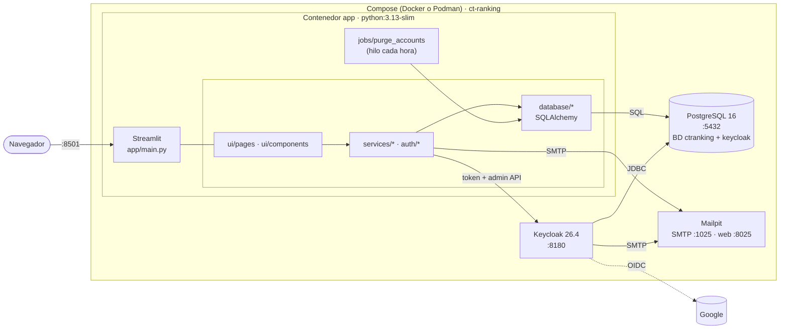
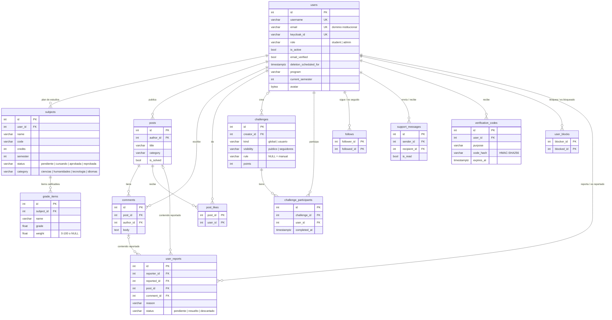

# 🎓 CT Ranking

Plataforma académica y social para estudiantes de la **Fundación Universitaria del Área Andina**.
Reúne en un solo lugar:

- el **plan de estudios** del estudiante, con sus notas, promedios y avance de créditos;
- **foros** para resolver dudas;
- **retos** con ranking, que motivan buenos hábitos;
- una **red de apoyo** entre compañeros;
- un **panel de administración** para hacer seguimiento académico.

Está construida con **Streamlit**, **PostgreSQL** y **Keycloak**.

---

## Contenido

- [Funcionalidades](#funcionalidades)
- [Roles](#roles)
- [Arquitectura](#arquitectura)
- [Servicios y dominios desplegados](#servicios-y-dominios-desplegados)
- [Tecnologías y dependencias](#tecnologías-y-dependencias)
- [Instalación y puesta en marcha](#instalación-y-puesta-en-marcha)
- [Comandos (`make`)](#comandos-make)
- [Configuración](#configuración)
- [Accesos y usuarios de prueba](#accesos-y-usuarios-de-prueba)
- [Estructura de archivos](#estructura-de-archivos)
- [Modelo relacional](#modelo-relacional)
- [Calidad y pruebas](#calidad-y-pruebas)
- [Documentación](#documentación)

---

## Funcionalidades

| Módulo | Qué ofrece |
|--------|-----------|
| 🏠 **Inicio** | Promedio general y del semestre, puntos y posición en el ranking, retos en curso con su progreso, últimas discusiones, apoyos recibidos y actividad de las personas que sigues. |
| 💬 **Foros** | Publicaciones con categoría, etiquetas y Markdown; comentarios, «me gusta» y estado *resuelta*; búsqueda, filtros (incluido «sólo de personas que sigo») y orden. |
| 📚 **Plan académico** | Carga del **pensum de Ingeniería de Software** (9 semestres, 60 materias, 148 créditos). Materias con semestre, créditos, categoría y estado. Ítems calificables (nombre, descripción, nota y %). **Promedios** del semestre y general ponderados por créditos. Gráficas de **avance de créditos por categoría** y de **evolución del promedio**. Historia académica y plan completo por semestre, con botones **Expandir/Colapsar todo**. |
| 🏆 **Retos** | 10 **retos globales** que se verifican automáticamente y **retos de la comunidad** creados por estudiantes (con evidencia, fechas y visibilidad pública o sólo para seguidores). A la derecha, un **banner de ranking**: participantes, quién llegó primero y orden de llegada. Ranking general y entre amigos, con **+50 %** de puntos para el primero en completar un reto. |
| 👥 **Personas** | Búsqueda, seguir y dejar de seguir, perfil público con logros, **mensajes de apoyo** («¡Vamos, tú puedes!»), **reportar** y **bloquear**. |
| 💌 **Mensajes** | Bandeja de mensajes de apoyo recibidos y enviados, con contador de no leídos y opción de responder. |
| 👤 **Mi perfil** | Nombre, alias, foto, biografía, datos académicos, correo institucional y contraseña. **Verificación en dos pasos (2FA con QR)**. **Eliminar la cuenta**: requiere doble verificación y la eliminación se hace a los 7 días. |
| 🛡️ **Panel de administrador** | Métricas globales, actividad, **estudiantes en riesgo**, detalle completo por estudiante, análisis de **grupos** con exportación a CSV, **moderación** de contenido, gestión de **reportes** y de usuarios. |

**Seguridad de las cuentas:**

- **Correo institucional obligatorio** (`@estudiantes.areandina.edu.co`).
- **Activación** de la cuenta con un enlace enviado por correo.
- **Crear cuenta / iniciar sesión con Google** para cuentas institucionales. Iniciar sesión sólo
  funciona si la cuenta ya existe.
- **2FA (TOTP)** con Google Authenticator, Microsoft Authenticator o FreeOTP. El código se pide
  sólo después de una contraseña correcta.
- Protección contra **fuerza bruta**.
- **Eliminación diferida** con cancelación posible.

Detalle en [`docs/14`](docs/14-cuentas-seguridad-y-moderacion.md) y
[`docs/15`](docs/15-inicio-sesion-con-google.md).

## Roles

| Rol | Puede |
|-----|-------|
| **Estudiante** | Usar todos los módulos sobre su información, crear retos de la comunidad, reportar y bloquear. |
| **Administrador** | Todo lo anterior, más: panel de administrador, retos globales con verificación automática, moderación de contenido, gestión de reportes, roles y estado de las cuentas. Está exento del dominio institucional. |

## Arquitectura



- **Capas:**
  - **`ui/`**: páginas y componentes de Streamlit.
  - **`services/`**: lógica de negocio por dominio, sin Streamlit.
  - **`auth/`**: identidad, a través de Keycloak.
  - **`database/`**: modelos, sesión y datos iniciales.
  - **`core/`**: configuración y correo.
- **Escrituras:** cada escritura de la UI se hace en su propia transacción
  (`actions.run_action`). Los servicios validan y lanzan errores con mensajes en español.
- **Cálculos:** promedios, créditos y rankings **no se guardan**. Se calculan al vuelo a partir
  de las tablas base.

Más detalle en [`docs/04-arquitectura.md`](docs/04-arquitectura.md).

## Servicios y dominios desplegados

| Servicio | URL / puerto (desarrollo) | Uso | Credenciales por defecto |
|----------|---------------------------|-----|--------------------------|
| **Aplicación** (Streamlit) | http://localhost:8501 | Plataforma para estudiantes y administradores. | `admin` / `Admin123!` o usuarios demo |
| **Keycloak** (identidad) | http://localhost:8180 — realm `ct-ranking` | Usuarios, contraseñas, activación por correo, 2FA y Google. | Consola: `admin` / `admin` |
| **Mailpit** (correo de desarrollo) | http://localhost:8025 (web) · `localhost:1025` (SMTP) | Atrapa y muestra todos los correos (activación, 2FA, códigos). | — |
| **PostgreSQL 16** | `localhost:5432` | BD `ctranking` (app) y `keycloak` (Keycloak). | `ctranking` / `ctranking` |
| **Google** (opcional) | `accounts.google.com` vía Keycloak | «Crear cuenta con Google» e «Iniciar sesión con Google» (sólo cuentas existentes) para cuentas institucionales. | Credenciales OAuth en `.env` |

**Dominios configurados:**

- `@estudiantes.areandina.edu.co`: dominio obligatorio del correo de los estudiantes
  (`STUDENT_EMAIL_DOMAIN`). También es el `hostedDomain` del login con Google. Areandina usa
  Google Workspace.
- **`APP_URL`** y **`KEYCLOAK_URL`**: URLs públicas de la app y de Keycloak. Se usan para los
  enlaces de los correos, el retorno desde Keycloak y Google, y las URIs de redirección.

Todos los puertos son configurables en `.env`. Las recomendaciones de producción (HTTPS, proxy,
SMTP real, secretos y cron) están en [`docs/03`](docs/03-despliegue-y-operacion.md).

## Tecnologías y dependencias

| Ámbito | Tecnología | Versión |
|--------|------------|---------|
| Interfaz | Streamlit (incluye `st.login` OIDC) | 1.66.0 |
| ORM y BD | SQLAlchemy · psycopg (binario) · PostgreSQL | 2.1.5 · 3.3.6 · 16 |
| Identidad | Keycloak · requests · Authlib · httpx | 26.4 · 2.34.2 · 1.8.0 · 0.28.1 |
| Correo | Mailpit (desarrollo) · `smtplib` | 1.31.3 |
| Datos y gráficas | pandas · Plotly | 3.0.6 · 7.1.0 |
| Utilidades | bcrypt · Pillow · python-dotenv | 5.0.0 · 12.3.0 · 1.2.4 |
| Calidad | pytest · ruff · isort · pre-commit | 9.1.1 · 0.17.1 · 9.0.2 · 4.7.0 |
| Infraestructura | Docker Compose o Podman · GNU Make · imagen `python:3.13-slim` | v2 / 4.7+ · 4.x · 3.13 |

Las versiones exactas están en [`requirements.txt`](requirements.txt) y
[`requirements-dev.txt`](requirements-dev.txt).

## Instalación y puesta en marcha

**Requisitos:**

- Docker (con `docker compose`) **o** Podman (con `podman compose`), `make` y Git.
- Python 3.12+ sólo si vas a desarrollar (pruebas y lint en `.venv`).
- Unos 1,5 GB de RAM libres.
- Puertos libres: 5432, 8180, 1025, 8025 y 8501.

```bash
make up          # imagen de la app + PostgreSQL + Keycloak + Mailpit; configuración; app
make seed-demo   # (opcional) estudiantes y contenido de demostración
                 # app en http://localhost:8501
make create      # (desarrollo) .venv con pytest/ruff/isort y hooks de pre-commit
```

`make` usa Docker si está instalado y si no Podman (`make up ENGINE=podman` para forzarlo). Los
archivos de contenedores están en [`container/`](container/) y las limitaciones de Podman en
[`docs/03`](docs/03-despliegue-y-operacion.md#docker-y-podman).

Detalle de cada paso en [`docs/02`](docs/02-requisitos-e-instalacion.md).

## Comandos (`make`)

| Comando | Qué hace |
|---------|----------|
| `make create` | Crea `.env`, instala las herramientas de calidad en `.venv` y los hooks de pre-commit. |
| `make up` / `make down` | Construye la imagen, levanta y configura todo, o lo detiene. `down` conserva los datos. |
| `make run` / `make dev` | Reconstruye y reinicia la app, o la levanta con el código montado y recarga al guardar. |
| `make shell` | Terminal dentro de la imagen de la app. |
| `make logs` / `make ps` | Logs y estado de los contenedores. |
| `make init-db` | Crea tablas, agrega columnas nuevas y carga los datos base. Es idempotente. |
| `make seed-demo` | Carga los datos de demostración. Es idempotente. |
| `make reset-db` | Recrea las tablas de la app. **Borra los datos.** |
| `make purge-accounts` | Borra las cuentas cuyo plazo de eliminación venció. |
| `make migrate-emails` | Pasa los correos de los estudiantes al dominio institucional (`ARGS=--dry-run` para simular). |
| `make test` | Ejecuta las pruebas en `.venv`. No requiere contenedores. |
| `make lint` / `make format` | Ejecuta pre-commit (isort + ruff) o formatea el código. |
| `make clean` / `make destroy` | Limpia las cachés o baja todo **borrando los volúmenes**. |

## Configuración

Toda la configuración está en `.env`, creado a partir de [`.env.example`](.env.example).
Las variables principales:

| Grupo | Variables |
|-------|-----------|
| Base de datos | `POSTGRES_USER`, `POSTGRES_PASSWORD`, `POSTGRES_DB`, `POSTGRES_HOST`, `POSTGRES_PORT` (o `DATABASE_URL`) |
| Autenticación | `AUTH_PROVIDER` (`keycloak` o `local`), `KEYCLOAK_URL`, `KEYCLOAK_REALM`, `KEYCLOAK_CLIENT_ID`, `KEYCLOAK_CLIENT_SECRET`, `APP_ADMIN_*` |
| Google (opcional) | `GOOGLE_CLIENT_ID`, `GOOGLE_CLIENT_SECRET`, `AUTH_COOKIE_SECRET` |
| Correo | `SMTP_HOST`, `SMTP_PORT`, `SMTP_USER`, `SMTP_PASSWORD`, `SMTP_STARTTLS`, `MAIL_FROM`, `KEYCLOAK_SMTP_*` |
| Reglas | `STUDENT_EMAIL_DOMAIN`, `ACCOUNT_DELETION_DAYS`, `GRADE_MIN`, `GRADE_MAX`, `GRADE_PASSING` |
| App | `APP_URL`, `APP_PORT` |

La tabla completa, con valores por defecto, está en
[`docs/02`](docs/02-requisitos-e-instalacion.md#variables-de-entorno-env).

## Accesos y usuarios de prueba

| Cuenta | Usuario | Contraseña | Notas |
|--------|---------|------------|-------|
| Administrador | `admin` | `Admin123!` | Configurable en `.env` |
| Estudiante, semestre 1 | `diego.lopez` · `valentina.rios` | `Demo1234` | Diego está **en riesgo** académico |
| Estudiante, semestres 2–3 | `carlos.ruiz` · `sofia.herrera` | `Demo1234` | |
| Estudiante, semestres 5–6 | `laura.gomez` · `mateo.castro` | `Demo1234` | Mateo tiene materias repetidas |
| Estudiante, semestres 8–9 | `juan.perez` · `ana.martinez` | `Demo1234` | |

- Los estudiantes demo tienen correo `<usuario>@estudiantes.areandina.edu.co` y pueden entrar con
  el usuario o con el correo.
- La consola de Keycloak (`admin` / `admin`) es distinta del administrador de la plataforma.

## Estructura de archivos

```
ct-ranking-platform/
├── app/
│   ├── main.py                 # Entrada: navegación, sesión y tarea de purga
│   ├── core/                   # config.py (.env) · mailer.py (SMTP)
│   ├── database/               # models.py · session.py · init_db.py
│   │   └── seeds/              #   base.py (admin, retos globales) · demo.py · pensums.py
│   ├── auth/                   # service.py (API) · keycloak.py · validation.py · passwords.py
│   │                           #   errors.py · accounts.py (eliminación diferida)
│   ├── services/               # academics · challenges · challenge_rules · forum · social
│   │                           #   users · moderation · admin
│   ├── jobs/                   # purge_accounts.py
│   └── ui/
│       ├── pages/              # login · home · forum · academics · challenges · community
│       │                       #   messages · profile · admin · account_pending
│       ├── components/         # session · actions · formatting · widgets · charts
│       │                       #   rankings · moderation · sidebar
│       └── assets/             # sidebar_hover.js
├── container/                  # Dockerfile · compose.yaml · compose.dev.yaml
│                               #   keycloak/ct-ranking-realm.json · postgres/ (BD de Keycloak)
├── scripts/                    # wait_for_services · configure_keycloak
│                               #   write_streamlit_secrets · migrate_student_emails
├── tests/                      # Una prueba por dominio (SQLite en memoria)
├── docs/                       # Documentación técnica (01–15), enunciado, resumen y pensum
├── .streamlit/config.toml      # Tema y servidor (secrets.toml se genera y no se versiona)
├── Makefile · pyproject.toml · .pre-commit-config.yaml · .dockerignore
├── requirements.txt · requirements-dev.txt · .env.example · .gitignore
└── README.md · CLAUDE.md
```

Qué contiene cada archivo: [`docs/04-arquitectura.md`](docs/04-arquitectura.md#estructura-de-carpetas).

## Modelo relacional



- **Borrado en cascada:** todas las claves foráneas tienen `ON DELETE CASCADE`. Las excepciones
  son las referencias de los reportes al contenido y al administrador, que quedan en `NULL` para
  conservar el reporte.
- **Contraseñas y 2FA:** viven en la BD de **Keycloak**, nunca en la de la app.
- **Detalle completo:** columnas, índices y restricciones en
  [`docs/06-modelo-de-datos.md`](docs/06-modelo-de-datos.md).

## Calidad y pruebas

- **Pruebas:** 37 pruebas con **pytest**, organizadas por dominio (`tests/test_<dominio>.py`).
  - Usan SQLite en memoria, autenticación local y correo en memoria, así que no necesitan contenedores.
  - Ejecutar todas: `make test`. Una sola:
    `.venv/bin/python -m pytest tests/test_auth.py::test_register_and_login_local`.
- **pre-commit:** ejecuta **isort**, **ruff check** (`--fix`), **ruff format** y hooks de
  higiene en cada commit. La configuración está en `pyproject.toml` y `.pre-commit-config.yaml`.
- **Pruebas de punta a punta:** los flujos de navegador (activación, 2FA, Google, menú lateral)
  se probaron con Selenium y Firefox headless contra los servicios reales. Ver
  [`docs/12`](docs/12-desarrollo-y-pruebas.md).

## Documentación

| | |
|---|---|
| [Índice de la documentación](docs/README.md) | Las 15 guías técnicas. |
| [Visión general](docs/01-vision-general.md) · [Instalación](docs/02-requisitos-e-instalacion.md) · [Despliegue](docs/03-despliegue-y-operacion.md) | Qué es, cómo se instala y cómo se opera. |
| [Arquitectura](docs/04-arquitectura.md) · [Autenticación](docs/05-autenticacion.md) · [Modelo de datos](docs/06-modelo-de-datos.md) · [Persistencia](docs/07-persistencia.md) | Cómo funciona por dentro. |
| [Servicios](docs/08-servicios.md) · [Páginas](docs/09-paginas-y-vistas.md) · [Reglas de negocio](docs/10-reglas-de-negocio.md) | Qué hace cada módulo y cada página. |
| [Datos y demo](docs/11-datos-iniciales-y-demo.md) · [Desarrollo y pruebas](docs/12-desarrollo-y-pruebas.md) · [Solución de problemas](docs/13-solucion-de-problemas.md) | Trabajo diario. |
| [Cuentas y moderación](docs/14-cuentas-seguridad-y-moderacion.md) · [Login con Google](docs/15-inicio-sesion-con-google.md) | Seguridad e identidad. |
| [Enunciado](docs/enunciado.md) · [Resumen del proyecto](docs/resumen-del-proyecto.md) | Qué se pidió y qué se construyó. |
