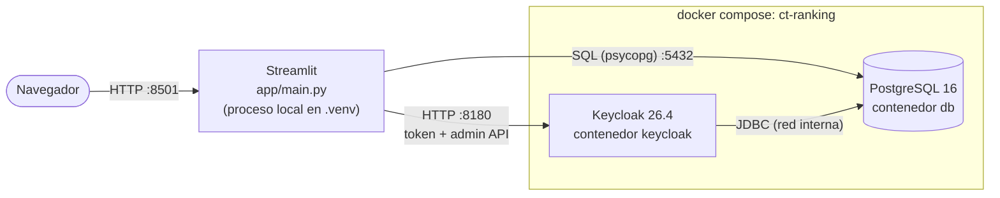

# 3. Despliegue y operación

## Topología



- La **aplicación Streamlit** corre como un proceso de Python en el host, dentro de `.venv`.
- **PostgreSQL** y **Keycloak** corren en Docker. Compose crea la red `ct-ranking_default`.
- Keycloak usa la **misma instancia** de PostgreSQL pero una **base de datos distinta**
  (`keycloak`). El script `docker/postgres/01-create-keycloak-db.sql` la crea al inicializar el
  volumen.

## Servicios de `docker-compose.yml`

### `db`: PostgreSQL

| Propiedad | Valor |
|-----------|-------|
| Imagen | `postgres:16-alpine` |
| Puerto | `${POSTGRES_PORT:-5432}:5432` |
| Volumen | `pgdata` → `/var/lib/postgresql/data` (persistente) |
| Init scripts | `./docker/postgres` → `/docker-entrypoint-initdb.d` (sólo se ejecutan con el volumen vacío) |
| Healthcheck | `pg_isready` cada 5 s, 20 reintentos |
| Bases de datos | `ctranking` (app) y `keycloak` (Keycloak) |

### `keycloak`: servidor de identidad

| Propiedad | Valor |
|-----------|-------|
| Imagen | `quay.io/keycloak/keycloak:26.4` |
| Comando | `start-dev --import-realm` |
| Puerto | `${KEYCLOAK_PORT:-8180}:8080` |
| BD | `KC_DB=postgres`, `jdbc:postgresql://db:5432/keycloak` |
| Import | `./docker/keycloak` → `/opt/keycloak/data/import` (realm `ct-ranking-realm.json`) |
| Admin de consola | `KC_BOOTSTRAP_ADMIN_USERNAME/PASSWORD` ← `KEYCLOAK_ADMIN[_PASSWORD]` |
| Depende de | `db` en estado *healthy* |

Durante la importación, Keycloak reemplaza los *placeholders* `${KEYCLOAK_CLIENT_SECRET}`,
`${APP_ADMIN_USERNAME}`, `${APP_ADMIN_EMAIL}` y `${APP_ADMIN_PASSWORD}` del JSON del realm con
las variables de entorno del contenedor.

## Comandos de operación (`make help`)

| Comando | Qué hace |
|---------|----------|
| `make create` | `.env`, dependencias en `.venv` e instalación de los hooks de pre-commit. |
| `make env` | Crea `.env` desde `.env.example` si no existe. |
| `make install` | Instala o actualiza las dependencias de `requirements-dev.txt`. |
| `make up` | Levanta los contenedores, espera a que estén listos y ejecuta `init_db`. |
| `make run` | Ejecuta Streamlit en `APP_PORT` (por defecto 8501). |
| `make dev` | `make up` + `make run`. |
| `make down` | Detiene y elimina los contenedores. **Conserva** los volúmenes (datos). |
| `make restart` | `down` + `up`. |
| `make logs` | Sigue los logs de ambos contenedores (`docker compose logs -f`). |
| `make ps` | Estado de los contenedores. |
| `make init-db` | Crea las tablas que falten y los datos base (idempotente). |
| `make seed-demo` | Carga los datos de demostración (idempotente). |
| `make reset-db` | **Borra y recrea** todas las tablas de la app. No toca Keycloak. |
| `make test` | Ejecuta pytest. |
| `make lint` | `pre-commit run --all-files`. |
| `make format` | isort + `ruff check --fix` + `ruff format`. |
| `make clean` | Elimina las cachés (`__pycache__`, `.pytest_cache`, `.ruff_cache`). |
| `make destroy` | `docker compose down -v`: **borra los volúmenes** (BD de la app y de Keycloak). |

## Ciclo de vida típico

```bash
make up          # al empezar el día
make run         # Ctrl+C para detener Streamlit
make down        # al terminar (los datos se conservan)
```

Para empezar desde cero (se pierde todo):

```bash
make destroy && make up && make seed-demo
```

## Consolas y accesos

| Recurso | URL / comando | Credenciales por defecto |
|---------|---------------|--------------------------|
| Plataforma | http://localhost:8501 | `admin` / `Admin123!` o usuarios demo / `Demo1234` |
| Consola de Keycloak | http://localhost:8180 → realm `ct-ranking` | `admin` / `admin` |
| PostgreSQL (psql) | `docker compose exec db psql -U ctranking -d ctranking` | `ctranking` / `ctranking` |
| BD de Keycloak | `docker compose exec db psql -U ctranking -d keycloak` | igual |

## Respaldo y restauración

Toda la información persistente vive en el volumen `ct-ranking_pgdata`, en dos bases de datos.

```bash
# Respaldo
docker compose exec -T db pg_dump -U ctranking -Fc ctranking > backup_app.dump
docker compose exec -T db pg_dump -U ctranking -Fc keycloak  > backup_keycloak.dump

# Restauración (con los servicios arriba)
docker compose exec -T db pg_restore -U ctranking -d ctranking --clean < backup_app.dump
docker compose exec -T db pg_restore -U ctranking -d keycloak  --clean < backup_keycloak.dump
```

Hay que respaldar **ambas** bases de datos juntas. Las contraseñas viven en `keycloak` y los
perfiles en `ctranking`, y se enlazan por `users.keycloak_id`.

## Recomendaciones para un despliegue en producción

El proyecto está configurado para desarrollo local. Para publicarlo:

1. **Keycloak en modo producción.**
   - Usar `start` en lugar de `start-dev`, con TLS o detrás de un proxy (`KC_PROXY_HEADERS`,
     `KC_HOSTNAME`).
   - Cambiar todas las credenciales y el `KEYCLOAK_CLIENT_SECRET`.
   - Poner el realm en `sslRequired: external`.
2. **Secretos.**
   - No usar los valores por defecto de `.env.example`.
   - Gestionar `.env` fuera del repositorio. Ya está en `.gitignore`.
3. **Contenerizar la app.**
   - Crear un `Dockerfile` con `python:3.13-slim` que instale `requirements.txt` y ejecute
     `streamlit run app/main.py --server.address 0.0.0.0`.
   - Agregarlo como servicio en compose, con `POSTGRES_HOST=db` y `KEYCLOAK_URL=http://keycloak:8080`.
4. **Proxy inverso.**
   - Usar Nginx o Traefik con HTTPS delante de Streamlit y de Keycloak.
   - Streamlit necesita soporte de WebSocket (`/_stcore/stream`).
5. **Migraciones.**
   - Hoy el esquema se crea con `Base.metadata.create_all` y no hay migraciones.
   - Antes de tener datos reales conviene incorporar **Alembic**. Ver
     [Persistencia](07-persistencia.md#evolución-del-esquema).
6. **Respaldos programados** de ambas bases de datos (ver arriba).
