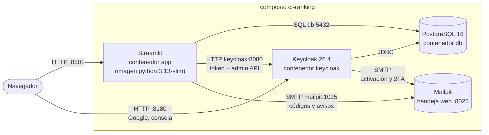

# 3. Despliegue y operación

## Topología

Todo corre en contenedores, definidos en `container/compose.yaml`. Funciona igual con **Docker**
y con **Podman** (ver [Docker y Podman](#docker-y-podman)).



- La **aplicación Streamlit** corre en el contenedor `app`, construido con
  `container/Dockerfile` sobre `python:3.13-slim`. El código va dentro de la imagen; `.env` se
  pasa al arrancar (`env_file`) y nunca se copia a la imagen (`.dockerignore`).
- Dentro de la red de compose (`ct-ranking_default`) los servicios se llaman por su nombre:
  compose fija para la app `POSTGRES_HOST=db`, `POSTGRES_PORT=5432` y
  `KEYCLOAK_URL=http://keycloak:8080`, sin importar lo que diga `.env`.
- El navegador sigue usando `http://localhost:8180` para Keycloak (login con Google, consola,
  enlaces de los correos). `KC_HOSTNAME=${KEYCLOAK_PUBLIC_URL}` fija esa URL como emisor de los
  tokens, y `KC_HOSTNAME_BACKCHANNEL_DYNAMIC=true` deja que la app use la red interna para las
  llamadas servidor a servidor.
- Keycloak usa la **misma instancia** de PostgreSQL pero una **base de datos distinta**
  (`keycloak`). El script `container/postgres/01-create-keycloak-db.sql` la crea al inicializar
  el volumen.

## Archivos de `container/`

| Archivo | Para qué |
|---------|----------|
| `Dockerfile` | Imagen de la app: instala `requirements.txt`, copia `app/`, `scripts/` y `.streamlit/config.toml`, y corre como el usuario sin privilegios `app` (uid 10001). Al arrancar genera `secrets.toml` y ejecuta Streamlit. |
| `compose.yaml` | Servicios `db`, `keycloak`, `mailpit`, `setup` y `app`. |
| `compose.dev.yaml` | Se suma en `make dev`: monta `app/` y `scripts/` del host (sólo lectura) y activa la recarga al guardar. |
| `keycloak/ct-ranking-realm.json` | Realm que Keycloak importa en el primer arranque. |
| `postgres/01-create-keycloak-db.sql` | Crea la base de datos de Keycloak. |

El contexto de compilación es la raíz del repositorio, así que el `.dockerignore` está en la raíz
(Docker y Podman lo leen ahí).

## Servicios de `container/compose.yaml`

### `db`: PostgreSQL

| Propiedad | Valor |
|-----------|-------|
| Imagen | `docker.io/library/postgres:16-alpine` |
| Puerto | `${BIND_ADDRESS:-127.0.0.1}:${POSTGRES_PORT:-5432}:5432` |
| Volumen | `pgdata` → `/var/lib/postgresql/data` (persistente) |
| Init scripts | `./postgres` → `/docker-entrypoint-initdb.d` (sólo se ejecutan con el volumen vacío) |
| Healthcheck | `pg_isready` cada 5 s, 20 reintentos |
| Bases de datos | `ctranking` (app) y `keycloak` (Keycloak) |

### `keycloak`: servidor de identidad

| Propiedad | Valor |
|-----------|-------|
| Imagen | `quay.io/keycloak/keycloak:26.4` |
| Comando | `start-dev --import-realm` |
| Puerto | `${BIND_ADDRESS:-127.0.0.1}:${KEYCLOAK_PORT:-8180}:8080` |
| BD | `KC_DB=postgres`, `jdbc:postgresql://db:5432/keycloak` |
| URL pública | `KC_HOSTNAME=${KEYCLOAK_PUBLIC_URL:-http://localhost:8180}`, `KC_HOSTNAME_BACKCHANNEL_DYNAMIC=true` |
| Import | `./keycloak` → `/opt/keycloak/data/import` (realm `ct-ranking-realm.json`) |
| Admin de consola | `KC_BOOTSTRAP_ADMIN_USERNAME/PASSWORD` ← `KEYCLOAK_ADMIN[_PASSWORD]` |
| Depende de | `db` en estado *healthy* |

Durante la importación, Keycloak reemplaza los *placeholders* `${KEYCLOAK_CLIENT_SECRET}`,
`${APP_ADMIN_USERNAME}`, `${APP_ADMIN_EMAIL}` y `${APP_ADMIN_PASSWORD}` del JSON del realm con
las variables de entorno del contenedor.

### `mailpit`: SMTP de desarrollo

| Propiedad | Valor |
|-----------|-------|
| Imagen | `docker.io/axllent/mailpit:v1.31.3` |
| Puertos | `${MAILPIT_SMTP_PORT:-1025}:1025` (SMTP) y `${MAILPIT_UI_PORT:-8025}:8025` (web), ambos en `${BIND_ADDRESS:-127.0.0.1}` |
| Uso | Atrapa **todos** los correos de Keycloak y de la app, y los muestra en http://localhost:8025 sin enviarlos. La app lo usa con `SMTP_HOST=mailpit`. |
| Producción | Se reemplaza por un SMTP real cambiando las variables `SMTP_*` y `KEYCLOAK_SMTP_*` (ver [Cuentas y seguridad](14-cuentas-seguridad-y-moderacion.md#correo-mailpit-y-smtp)). |

### `setup`: configuración inicial (una sola vez)

| Propiedad | Valor |
|-----------|-------|
| Imagen | la de la app |
| Perfil | `setup`: `compose up` no lo arranca; `make up` lo ejecuta con `compose --profile setup run --rm setup` |
| Comando | `python -m scripts.wait_for_services`, `python -m scripts.configure_keycloak` y `python -m app.database.init_db` |

Es idempotente: se ejecuta en cada `make up`.

### `app`: Streamlit

| Propiedad | Valor |
|-----------|-------|
| Imagen | `localhost/ct-ranking-app:latest` (construida desde `container/Dockerfile`) |
| Puerto | `${BIND_ADDRESS:-127.0.0.1}:${APP_PORT:-8501}:8501` |
| Volumen | `streamlit` → `/home/app/.streamlit`: guarda `secrets.toml` (secreto de la cookie de `st.login`) entre reinicios |
| Arranque | `python -m scripts.write_streamlit_secrets` y luego `streamlit run app/main.py` |
| Healthcheck | `GET /_stcore/health` cada 15 s |

## Comandos de operación (`make help`)

El Makefile usa `docker` si está instalado y si no `podman`. Para forzar uno:
`make up ENGINE=podman`. Todos los comandos de la app se ejecutan dentro de su imagen; `.venv` sólo
se usa para las herramientas de calidad (`make test`, `make lint`, `make format`).

| Comando | Qué hace |
|---------|----------|
| `make up` | Construye la imagen de la app, levanta `db`, `keycloak` y `mailpit`, ejecuta `setup` (espera, configura Keycloak, crea tablas y datos base) y arranca la app en http://localhost:8501. |
| `make dev` | Como `up`, pero monta el código del host en la app (recarga al guardar) y sigue sus logs. |
| `make run` | Reconstruye la imagen y reinicia sólo la app (tras cambiar código o `requirements.txt`). |
| `make build` | Sólo construye la imagen de la app. |
| `make down` | Detiene y elimina los contenedores. **Conserva** los volúmenes (datos). |
| `make restart` | `down` + `up`. |
| `make logs` | Sigue los logs de los contenedores. |
| `make ps` | Estado de los contenedores. |
| `make shell` | Abre `bash` en un contenedor nuevo de la app (con la misma configuración). |
| `make init-db` | Crea las tablas que falten y los datos base (idempotente). |
| `make seed-demo` | Carga los datos de demostración (idempotente). |
| `make reset-db` | **Borra y recrea** todas las tablas de la app. No toca Keycloak. |
| `make purge-accounts` | Borra definitivamente las cuentas cuyo plazo de eliminación venció (en la app y en Keycloak). |
| `make migrate-emails` | Pasa el correo de los estudiantes existentes al dominio institucional, en la app y en Keycloak. `ARGS=--dry-run` sólo muestra los cambios. |
| `make create` | Crea `.env`, instala las herramientas de calidad en `.venv` y los hooks de pre-commit. |
| `make env` | Crea `.env` desde `.env.example` si no existe. |
| `make install` | Instala o actualiza `requirements-dev.txt` en `.venv`. |
| `make test` | Ejecuta pytest en `.venv` (no necesita contenedores). |
| `make lint` | `pre-commit run --all-files`. |
| `make format` | isort + `ruff check --fix` + `ruff format`. |
| `make clean` | Elimina las cachés (`__pycache__`, `.pytest_cache`, `.ruff_cache`). |
| `make destroy` | `compose down -v`: **borra los volúmenes** (BD de la app y de Keycloak, y `secrets.toml`). |

Sin `make`, los mismos comandos se pueden ejecutar desde la raíz del repositorio:

```bash
docker compose --env-file .env -f container/compose.yaml up -d db keycloak mailpit
docker compose --env-file .env -f container/compose.yaml --profile setup run --rm setup
docker compose --env-file .env -f container/compose.yaml up -d --build app
# Con Podman: lo mismo cambiando "docker" por "podman".
```

`--env-file .env` es necesario porque compose busca `.env` junto al archivo de compose
(`container/`), no en la raíz.

## Ciclo de vida típico

```bash
make up          # al empezar el día (o make dev para editar código con recarga)
make run         # tras cambiar código sin make dev
make down        # al terminar (los datos se conservan)
```

Para empezar desde cero (se pierde todo):

```bash
make destroy && make up && make seed-demo
```

## Docker y Podman

`make` funciona con los dos. Requisitos:

- **Docker:** Docker Engine con el plugin `docker compose` (v2).
- **Podman:** Podman 4.7 o superior (trae `podman compose`) y un *provider* de compose instalado:
  `podman-compose` 1.1 o superior, o `docker-compose`. `podman compose` delega en él.

Limitaciones y cómo se resolvieron:

| Limitación | Solución en el proyecto |
|------------|-------------------------|
| Podman no resuelve nombres cortos de imagen (`postgres:16`) sin configuración extra. | Todas las imágenes tienen nombre completo (`docker.io/...`, `quay.io/...`, `localhost/...`). |
| En Fedora/RHEL (SELinux) Podman no deja leer carpetas montadas del host. | Los bind mounts llevan la opción `z`. En sistemas sin SELinux se ignora. |
| Con Podman *rootless* los archivos montados del host cambian de dueño dentro del contenedor; un usuario no root no puede escribirlos. | La app nunca escribe en carpetas del host: `secrets.toml` va a un volumen y los montajes de `make dev` son de sólo lectura. |
| Compose lee `.env` de la carpeta del archivo de compose. | El Makefile pasa `--env-file .env`. |
| Podman ignora `HEALTHCHECK` en el `Dockerfile` (formato de imagen OCI). | El healthcheck de la app está en `compose.yaml`. |
| `podman-compose` antiguo no entiende `depends_on: condition: service_healthy`, y sin systemd Podman no ejecuta los healthchecks periódicos. | Usar `podman-compose` ≥ 1.1 en un sistema con systemd. `setup` espera a PostgreSQL y Keycloak por su cuenta (`wait_for_services`), así que la configuración no depende de los healthchecks. |
| Docker Desktop y `podman machine` (macOS/Windows) corren en una VM: los cambios de archivos montados no siempre generan eventos. | `make dev` usa `STREAMLIT_SERVER_FILE_WATCHER_TYPE=poll`. |
| Docker y Podman guardan imágenes y volúmenes por separado. | Al cambiar de motor se parte de cero: los datos de uno no aparecen en el otro. Respalda antes (ver abajo). |

## Consolas y accesos

En los comandos, `$COMPOSE` es `docker compose --env-file .env -f container/compose.yaml` (o
`podman compose ...`).


| Recurso | URL / comando | Credenciales por defecto |
|---------|---------------|--------------------------|
| Plataforma | http://localhost:8501 | `admin` / `Admin123!` o usuarios demo / `Demo1234` |
| Consola de Keycloak | http://localhost:8180 → realm `ct-ranking` | `admin` / `admin` |
| Correos (Mailpit) | http://localhost:8025 | sin credenciales |
| PostgreSQL (psql) | `$COMPOSE exec db psql -U ctranking -d ctranking` | `ctranking` / `ctranking` |
| BD de Keycloak | `$COMPOSE exec db psql -U ctranking -d keycloak` | igual |

## Respaldo y restauración

Toda la información persistente vive en el volumen `ct-ranking_pgdata`, en dos bases de datos.

```bash
# Respaldo
$COMPOSE exec -T db pg_dump -U ctranking -Fc ctranking > backup_app.dump
$COMPOSE exec -T db pg_dump -U ctranking -Fc keycloak  > backup_keycloak.dump

# Restauración (con los servicios arriba)
$COMPOSE exec -T db pg_restore -U ctranking -d ctranking --clean < backup_app.dump
$COMPOSE exec -T db pg_restore -U ctranking -d keycloak  --clean < backup_keycloak.dump
```

Hay que respaldar **ambas** bases de datos juntas. Las contraseñas viven en `keycloak` y los
perfiles en `ctranking`, y se enlazan por `users.keycloak_id`.

## Recomendaciones para un despliegue en producción

El proyecto está configurado para desarrollo local. Para publicarlo:

1. **Keycloak en modo producción.**
   - Usar `start` en lugar de `start-dev`, con TLS o detrás de un proxy (`KC_PROXY_HEADERS`), y
     `KEYCLOAK_PUBLIC_URL` con el dominio real (se usa como `KC_HOSTNAME`).
   - Cambiar todas las credenciales y el `KEYCLOAK_CLIENT_SECRET`.
   - Poner el realm en `sslRequired: external`.
2. **Secretos.**
   - No usar los valores por defecto de `.env.example`: en especial `KEYCLOAK_CLIENT_SECRET`,
     `KEYCLOAK_PWCHECK_CLIENT_SECRET`, `APP_SECRET_KEY` y `AUTH_COOKIE_SECRET`.
   - Gestionar `.env` fuera del repositorio. Ya está en `.gitignore`.
   - Los puertos de los contenedores se publican sólo en `127.0.0.1` (`BIND_ADDRESS`). Mailpit no tiene
     contraseña y muestra todos los códigos y enlaces: nunca debe quedar expuesto.
3. **Imagen de la app.**
   - La imagen de `container/Dockerfile` ya sirve para producción. Publicarla en un registro y
     no usar `compose.dev.yaml` (monta el código del host).
4. **Proxy inverso.**
   - Usar Nginx o Traefik con HTTPS delante de Streamlit y de Keycloak.
   - Streamlit necesita soporte de WebSocket (`/_stcore/stream`).
5. **Migraciones.**
   - Hoy el esquema se crea con `Base.metadata.create_all` y no hay migraciones.
   - Antes de tener datos reales conviene incorporar **Alembic**. Ver
     [Persistencia](07-persistencia.md#evolución-del-esquema).
6. **Respaldos programados** de ambas bases de datos (ver arriba).
7. **Correo real.** Reemplazar Mailpit por un SMTP real (`SMTP_*` y `KEYCLOAK_SMTP_*`) y
   ejecutar `make up` para reconfigurar Keycloak.
8. **Purga de cuentas.** El hilo de la app corre cada hora mientras la app esté en ejecución.
   Para no depender de ello, conviene programar `python -m app.jobs.purge_accounts` con cron
   o un timer de systemd.
