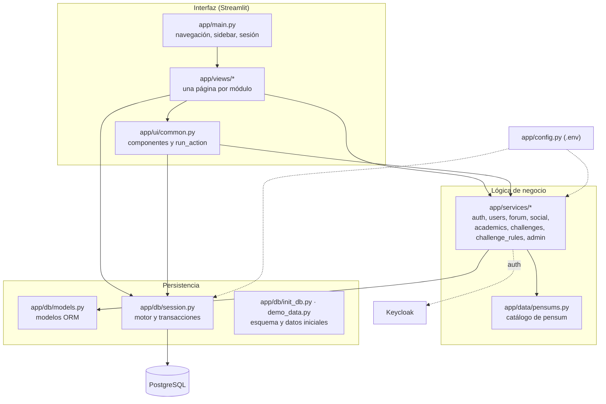
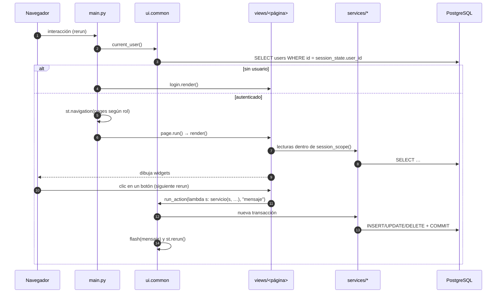

# 4. Arquitectura

## Tecnologías

| Tecnología | Versión | Rol en el proyecto |
|------------|---------|--------------------|
| [Streamlit](https://streamlit.io) | 1.66 | Interfaz web. Navegación multipágina (`st.navigation`), formularios, diálogos (`st.dialog`), tablas y gráficas. |
| [SQLAlchemy](https://www.sqlalchemy.org) | 2.1 | ORM con modelos declarativos tipados (`Mapped[...]`), consultas `select()` y manejo de transacciones. |
| psycopg | 3.3 | Driver de PostgreSQL para SQLAlchemy (`postgresql+psycopg://`). |
| PostgreSQL | 16 | Base de datos relacional de la app y de Keycloak. |
| Keycloak | 26.4 | Gestión de identidades: usuarios, contraseñas y roles. |
| requests | 2.34 | Cliente HTTP contra los endpoints de token y administración de Keycloak. |
| bcrypt | 5.0 | Hash de contraseñas con el proveedor de autenticación `local`. |
| pandas | 3.0 | Tablas y agregaciones del panel de administrador. |
| Plotly | 7.1 | Gráficas interactivas (promedios, avance de créditos, actividad, histogramas). |
| Pillow | 12.3 | Recorte y redimensionamiento de las fotos de perfil. |
| python-dotenv | 1.2 | Carga de `.env`. |
| Docker Compose | v2 | Orquestación de PostgreSQL y Keycloak. |
| pytest | 9.1 | Pruebas automáticas. |
| ruff · isort · pre-commit | 0.17 · 9.0 · 4.7 | Linter y formateador, orden de imports y hooks de Git. |

## Capas



**Principios de diseño:**

1. **Los servicios no dependen de Streamlit.**
   - Todas las funciones de `app/services/` reciben una `Session` de SQLAlchemy como primer
     argumento y lanzan excepciones de dominio con mensajes en español.
   - Así son fáciles de probar (las pruebas usan SQLite) y reutilizables desde scripts como
     `init_db` y `demo_data`.
2. **Las vistas sólo orquestan.**
   - Leen datos a través de los servicios dentro de un bloque `with session_scope()` y
     dibujan la interfaz.
   - Las escrituras pasan siempre por `common.run_action`.
3. **La configuración se centraliza** en `app/config.py` (`get_settings()`, en caché con
   `lru_cache`).
4. **Los datos de referencia viven en código.** El catálogo del pensum (`app/data/pensums.py`)
   y las reglas de retos (`app/services/challenge_rules.py`) están versionados con el código.

## Estructura de carpetas

```
ct-ranking-platform/
├── app/
│   ├── main.py                 # Entrada de Streamlit: navegación y control de sesión
│   ├── config.py               # Settings desde .env
│   ├── data/
│   │   └── pensums.py          # Catálogo de pensum (Ingeniería de Software)
│   ├── db/
│   │   ├── models.py           # Modelos ORM y enumeraciones
│   │   ├── session.py          # Motor, sessionmaker y session_scope()
│   │   ├── init_db.py          # CLI: crea el esquema y los datos base (--reset, --demo)
│   │   └── demo_data.py        # Datos de demostración
│   ├── services/               # Lógica de negocio (sin Streamlit)
│   │   ├── auth.py             # Login, registro, contraseñas; Keycloak o local
│   │   ├── users.py            # Perfil, avatar y búsqueda
│   │   ├── forum.py            # Publicaciones, comentarios, "me gusta"
│   │   ├── social.py           # Seguidores y mensajes de apoyo
│   │   ├── academics.py        # Materias, ítems, promedios, créditos, pensum
│   │   ├── challenges.py       # Retos, participación, ranking, leaderboard
│   │   ├── challenge_rules.py  # Reglas de verificación automática
│   │   └── admin.py            # Métricas y consultas del panel
│   ├── ui/
│   │   ├── common.py           # Sesión del usuario, run_action, avatares, banners
│   │   └── sidebar_hover.js    # Expande el menú lateral oculto al pasar el mouse
│   └── views/                  # Una página por archivo: render()
│       ├── login.py  home.py  forum.py  academics.py  challenges.py
│       └── community.py  messages.py  profile.py  admin.py
├── docker/
│   ├── keycloak/ct-ranking-realm.json   # Realm importado al arrancar
│   └── postgres/01-create-keycloak-db.sql
├── docs/                       # Esta documentación (+ pensum.png)
├── scripts/wait_for_services.py
├── tests/                      # Pruebas con pytest (SQLite en memoria)
├── .streamlit/config.toml
├── docker-compose.yml  Makefile  pyproject.toml  .pre-commit-config.yaml
├── requirements.txt  requirements-dev.txt  .env.example  .gitignore
└── README.md  PROYECTO.md  CLAUDE.md  project.md
```

## Ciclo de ejecución de Streamlit

Streamlit **re-ejecuta el script completo** (`app/main.py`) en cada interacción del usuario: un
clic, escribir en un campo o enviar un formulario. Sobre ese modelo, la aplicación funciona así:



### Estado de sesión (`st.session_state`)

| Clave | Quién la escribe | Significado |
|-------|------------------|-------------|
| `user_id` | `views/login.py` | Id del usuario autenticado. Su ausencia equivale a no tener sesión iniciada. |
| `_flash` | `ui.common.flash` | Avisos pendientes de mostrar como *toast* tras el rerun. |
| `post_id` | `views/forum.py` | Publicación abierta en vista de detalle. |
| `profile_id` | `views/community.py` | Perfil público que se está viendo. |
| `challenge_id` | `views/challenges.py` | Reto cuyo ranking muestra el banner derecho. |
| `pensum_program`, `support_tpl`, `support_msg`, … | widgets con `key` | Estado de widgets concretos. |

El estado de sesión vive en la memoria del servidor y está asociado a la conexión WebSocket del
navegador. **Al recargar la página se pierde** y el usuario debe volver a iniciar sesión.

### Navegación

`app/main.py` construye la navegación con `st.navigation`, a partir de funciones (no de
archivos):

- **Sin usuario:** se muestra únicamente `login.render`, con la navegación oculta.
- **Con usuario:**
  - *Plataforma:* Inicio (`/inicio`), Foros (`/foros`), Plan académico (`/academico`),
    Retos (`/retos`).
  - *Comunidad:* Personas (`/personas`), Mensajes de apoyo (`/mensajes`, con el contador de no
    leídos), Mi perfil (`/perfil`).
  - *Administración* (sólo `role == "admin"`): Panel de administrador (`/admin`). Además,
    `views/admin.py` vuelve a verificar el rol al renderizar.
- **Barra lateral:** avatar, nombre, programa y botón "Cerrar sesión", que limpia el
  `session_state`.
  - Si el menú está oculto, se expande al pasar el mouse por el borde izquierdo (ver
    [Páginas y vistas](09-paginas-y-vistas.md#menú-lateral-expandir-al-pasar-el-mouse)).

Si la base de datos no responde, `main.py` captura `OperationalError` y muestra un mensaje que
indica ejecutar `make up` y `make init-db`.

## Manejo de errores

| Tipo | Dónde se origina | Cómo se muestra |
|------|------------------|-----------------|
| Errores de dominio: `AuthError`, `AcademicError`, `ChallengeError`, `ForumError`, `SocialError`, `ProfileError` | Validaciones en servicios | `run_action` los captura y muestra `st.error(mensaje)`. La transacción hace rollback. |
| Errores de conexión a la BD (`OperationalError`) | `current_user()` en `main.py` | Mensaje con las instrucciones para levantar los servicios. |
| Errores de conexión a Keycloak | `KeycloakClient` | Se convierten en `AuthError("No fue posible contactar…")`. |
| Errores inesperados | Cualquier lugar | Streamlit los muestra con su traza (modo desarrollo). |
