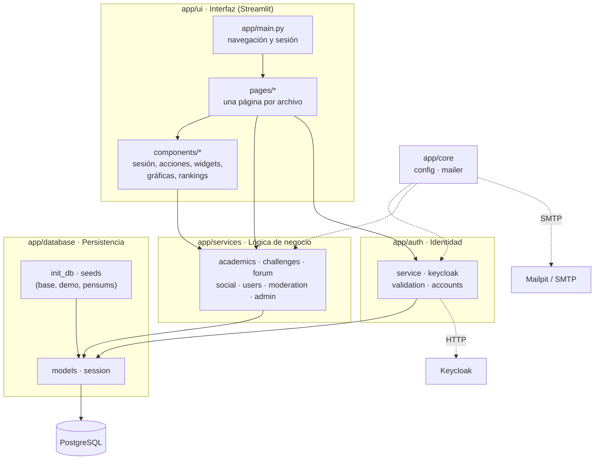
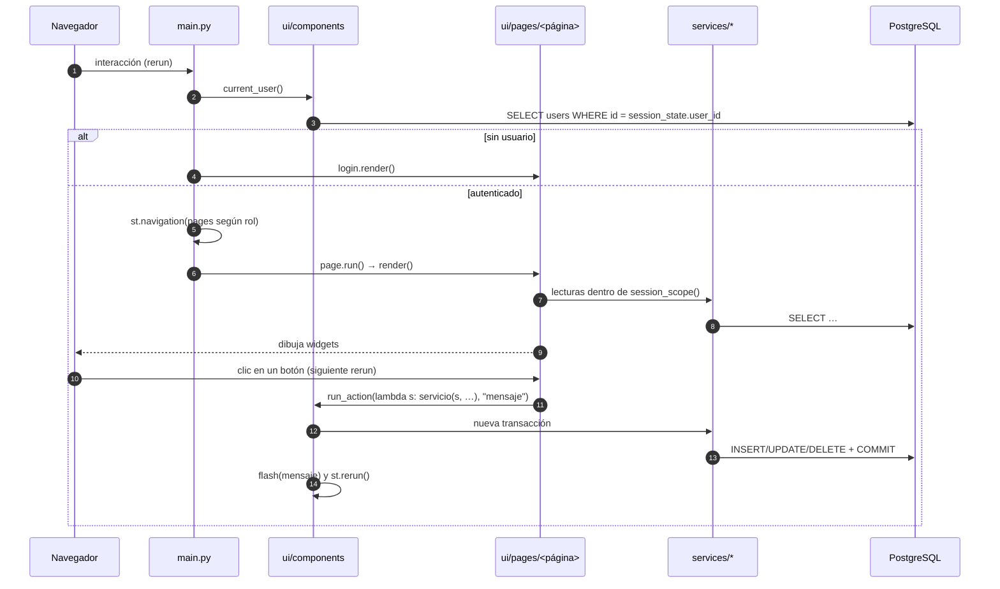

# 4. Arquitectura

## Tecnologías

| Tecnología | Versión | Rol en el proyecto |
|------------|---------|--------------------|
| [Streamlit](https://streamlit.io) | 1.66 | Interfaz web. Navegación multipágina (`st.navigation`), formularios, diálogos (`st.dialog`), tablas y gráficas. |
| [SQLAlchemy](https://www.sqlalchemy.org) | 2.1 | ORM con modelos declarativos tipados (`Mapped[...]`), consultas `select()` y manejo de transacciones. |
| psycopg | 3.3 | Driver de PostgreSQL para SQLAlchemy (`postgresql+psycopg://`). |
| PostgreSQL | 16 | Base de datos relacional de la app y de Keycloak. |
| Keycloak | 26.4 | Gestión de identidades: usuarios, contraseñas y roles. |
| requests | 2.34 | Cliente HTTP contra los endpoints de token y administración de Keycloak. |
| bcrypt | 5.0 | Hash de contraseñas con el proveedor de autenticación `local`. |
| pandas | 3.0 | Tablas y agregaciones del panel de administrador. |
| Plotly | 7.1 | Gráficas interactivas (promedios, avance de créditos, actividad, histogramas). |
| Pillow | 12.3 | Recorte y redimensionamiento de las fotos de perfil. |
| python-dotenv | 1.2 | Carga de `.env`. |
| Docker Compose / Podman | v2 / 4.7+ | Imagen de la app (`python:3.13-slim`) y orquestación de la app, PostgreSQL, Keycloak y Mailpit (`container/`). |
| Mailpit | 1.31 | SMTP de desarrollo: atrapa los correos y los muestra en una bandeja web. |
| pytest | 9.1 | Pruebas automáticas. |
| ruff · isort · pre-commit | 0.17 · 9.0 · 4.7 | Linter y formateador, orden de imports y hooks de Git. |

## Capas



**Principios de diseño:**

1. **Los servicios no dependen de Streamlit.**
   - Todas las funciones de `app/services/` reciben una `Session` de SQLAlchemy como primer
     argumento y lanzan excepciones de dominio con mensajes en español.
   - Así son fáciles de probar (las pruebas usan SQLite) y reutilizables desde scripts como
     `init_db` y `seeds/demo.py`.
2. **Las páginas sólo orquestan.**
   - Leen datos a través de los servicios dentro de un bloque `with session_scope()` y
     dibujan la interfaz.
   - Las escrituras pasan siempre por `actions.run_action` (`app/ui/components/actions.py`).
3. **La autenticación es un paquete propio** (`app/auth`): las páginas y servicios usan su
   API pública (`from app import auth`; `auth.login(...)`) sin conocer a Keycloak.
4. **La configuración se centraliza** en `app/core/config.py` (`get_settings()`, en caché con
   `lru_cache`).
5. **Los datos de referencia viven en código.** El catálogo del pensum (`app/database/seeds/pensums.py`)
   y las reglas de retos (`app/services/challenge_rules.py`) están versionados con el código.

## Estructura de carpetas

```
ct-ranking-platform/
├── app/
│   ├── main.py                     # Entrada de Streamlit: navegación, sesión y tarea de purga
│   ├── core/                       # Transversal
│   │   ├── config.py               #   Settings desde .env (get_settings)
│   │   ├── mailer.py               #   Envío de correos (SMTP o memoria)
│   │   └── ratelimit.py            #   Límite de intentos en memoria (login local, reenvíos)
│   ├── database/                   # Persistencia
│   │   ├── models.py               #   Modelos ORM y enumeraciones
│   │   ├── session.py              #   Motor, sessionmaker y session_scope()
│   │   ├── init_db.py              #   CLI: esquema, columnas/índices/CHECK nuevos y datos base
│   │   └── seeds/                  #   Datos de referencia
│   │       ├── base.py             #     Administrador y 10 retos globales
│   │       ├── demo.py             #     Datos de demostración (make seed-demo)
│   │       └── pensums.py          #     Catálogo de pensum (Ingeniería de Software)
│   ├── auth/                       # Autenticación e identidad
│   │   ├── service.py              #   API pública: login, registro, 2FA, Google, cambios de cuenta
│   │   ├── keycloak.py             #   Cliente HTTP de Keycloak (tokens y API de administración)
│   │   ├── validation.py           #   Usuario, correo institucional, nombres y contraseña
│   │   ├── passwords.py            #   Hash bcrypt (proveedor local)
│   │   ├── errors.py               #   AuthError, EmailNotVerifiedError
│   │   └── accounts.py             #   Eliminación diferida, cambio de correo verificado y purga
│   ├── services/                   # Lógica de negocio por dominio (sin Streamlit)
│   │   ├── academics.py            #   Materias, ítems, promedios, créditos, carga de pensum
│   │   ├── challenges.py           #   Retos, participación, ranking, leaderboard
│   │   ├── challenge_rules.py      #   Reglas de verificación automática
│   │   ├── forum.py                #   Publicaciones, comentarios, "me gusta"
│   │   ├── social.py               #   Seguidores y mensajes de apoyo
│   │   ├── users.py                #   Perfil, avatar y búsqueda
│   │   ├── moderation.py           #   Bloqueos y reportes
│   │   └── admin.py                #   Métricas y consultas del panel
│   ├── jobs/
│   │   └── purge_accounts.py       # Purga de cuentas vencidas (hilo y CLI)
│   └── ui/                         # Interfaz Streamlit
│       ├── pages/                  #   Una página por archivo, con render()
│       │   ├── login.py  home.py  forum.py  academics.py  challenges.py
│       │   └── community.py  messages.py  profile.py  admin.py  account_pending.py
│       ├── components/             #   Piezas reutilizables
│       │   ├── session.py          #     Usuario actual, logout, sesión OIDC (Google)
│       │   ├── actions.py          #     run_action, avisos (flash) y errores de dominio
│       │   ├── formatting.py       #     Formato de notas, fechas y categorías
│       │   ├── widgets.py          #     Avatares, chip de usuario, campo de correo institucional
│       │   ├── charts.py           #     Avance de créditos y evolución del promedio
│       │   ├── rankings.py         #     Banners de ranking por reto y general
│       │   ├── moderation.py       #     Menú «Más» y diálogos de reportar y bloquear
│       │   ├── support.py          #     Diálogo para enviar mensajes de apoyo
│       │   └── sidebar.py          #     Menú lateral que se expande con el mouse
│       └── assets/
│           └── sidebar_hover.js    #   JavaScript del menú lateral
├── container/                      # Contenedores (Docker y Podman)
│   ├── Dockerfile                  #   Imagen de la app (python:3.13-slim)
│   ├── compose.yaml                #   db, keycloak, mailpit, setup y app
│   ├── compose.dev.yaml            #   make dev: monta el código y recarga al guardar
│   ├── keycloak/ct-ranking-realm.json   # Realm importado al arrancar
│   └── postgres/01-create-keycloak-db.sql
├── scripts/                        # Operación (se ejecutan en la imagen con `python -m scripts.<nombre>`)
│   ├── wait_for_services.py        #   Espera a PostgreSQL y Keycloak
│   ├── configure_keycloak.py       #   SMTP, URLs de la app y proveedor Google en el realm
│   ├── write_streamlit_secrets.py  #   Genera secrets.toml para st.login (al arrancar la app)
│   └── migrate_student_emails.py   #   Pasa correos de estudiantes al dominio institucional
├── tests/                          # pytest por dominio (SQLite en memoria)
├── docs/                           # Documentación (+ enunciado, resumen y pensum.png)
├── .streamlit/config.toml          # Tema y servidor (secrets.toml se genera, no se versiona)
├── Makefile  pyproject.toml  .pre-commit-config.yaml  .dockerignore
├── requirements.txt  requirements-dev.txt  .env.example  .gitignore
└── README.md  CLAUDE.md
```

## Ciclo de ejecución de Streamlit

Streamlit **re-ejecuta el script completo** (`app/main.py`) en cada interacción del usuario: un
clic, escribir en un campo o enviar un formulario. Sobre ese modelo, la aplicación funciona así:



### Estado de sesión (`st.session_state`)

| Clave | Quién la escribe | Significado |
|-------|------------------|-------------|
| `user_id` | `session.start_session` (login) y `sync_oidc_session` (Google) | Id del usuario autenticado. Su ausencia equivale a no tener sesión iniciada. |
| `_login_at` | `session.start_session` | Hora del login con contraseña, para el vencimiento (`SESSION_TTL_HOURS`). |
| `_current_user` | `session.current_user` (desde `main.py`) | Usuario cargado en esta ejecución; `require_user()` lo reutiliza sin otra consulta. |
| `_otp_pending` | `ui/pages/login.py` | Paso 2 del login con 2FA (usuario y contraseña, como máximo 5 minutos). |
| `_flash` | `components.actions.flash` | Avisos pendientes de mostrar como *toast* tras el rerun. |
| `post_id` | `ui/pages/forum.py` | Publicación abierta en vista de detalle. |
| `profile_id` | `ui/pages/community.py` | Perfil público que se está viendo. |
| `challenge_id` | `ui/pages/challenges.py` | Reto cuyo ranking muestra el banner derecho. |
| `_unverified_login`, `_registered_email` | `ui/pages/login.py` | Aviso de cuenta sin activar (con el botón de reenvío) y aviso tras registrarse. |
| `_deletion_code_sent` | `ui/pages/profile.py` | Paso 2 de la eliminación de la cuenta (código enviado). |
| `_email_change_pending` | `ui/pages/profile.py` | Correo nuevo al que se envió el código de confirmación. |
| `_academics_open_expanders` | `ui/pages/academics.py` | Menús abiertos del plan académico. |
| `pensum_program`, `support_tpl`, `support_msg`, … | widgets con `key` | Estado de widgets concretos. |

El estado de sesión vive en la memoria del servidor y está asociado a la conexión WebSocket del
navegador. **Al recargar la página se pierde**: con usuario y contraseña hay que volver a iniciar
sesión. Con Google no, porque `st.login` guarda la sesión en una cookie firmada y
`sync_oidc_session()` la restaura (ver [Inicio de sesión con Google](15-inicio-sesion-con-google.md)).

### Navegación

`app/main.py` construye la navegación con `st.navigation`, a partir de funciones (no de
archivos):

- **Sin usuario:** se muestra únicamente `login.render`, con la navegación oculta.
- **Usuario con eliminación programada:** se muestra únicamente la pantalla «Tu cuenta será
  eliminada», con los botones Cancelar eliminación y Cerrar sesión.
- **Tarea en segundo plano:** al arrancar, `main.py` llama a `start_background_purge()`. Esto
  inicia, una vez por proceso, el hilo que purga cada hora las cuentas vencidas. El hilo usa un
  evento de parada (`stop_background_purge`, registrado con `atexit`).
- **Con usuario:**
  - *Plataforma:* Inicio (`/inicio`), Foros (`/foros`), Plan académico (`/academico`),
    Retos (`/retos`).
  - *Comunidad:* Personas (`/personas`), Mensajes de apoyo (`/mensajes`, con el contador de no
    leídos), Mi perfil (`/perfil`).
  - *Administración* (sólo `role == "admin"`): Panel de administrador (`/admin`). Además,
    `ui/pages/admin.py` vuelve a verificar el rol al renderizar.
- **Barra lateral:** avatar, nombre, programa (escapados como HTML) y botón "Cerrar sesión", que limpia el
  `session_state`.
  - Si el menú está oculto, se expande al pasar el mouse por el borde izquierdo (ver
    [Páginas y vistas](09-paginas-y-vistas.md#menú-lateral-expandir-al-pasar-el-mouse)).

Si la base de datos no responde, `main.py` captura `OperationalError` y muestra un mensaje que
indica ejecutar `make up` y `make init-db`.

## Manejo de errores

| Tipo | Dónde se origina | Cómo se muestra |
|------|------------------|-----------------|
| Errores de dominio: `AuthError` (y `EmailNotVerifiedError`), `AccountError`, `AdminError`, `MailError`, `ModerationError`, `AcademicError`, `ChallengeError`, `ForumError`, `SocialError`, `ProfileError` | Validaciones en servicios | `run_action` los captura y muestra `st.error(mensaje)`. La transacción hace rollback, salvo los que heredan de `CommitBeforeRaiseError` (p. ej. un código incorrecto, cuyo intento fallido se guarda). |
| `IntegrityError` (fila duplicada) | Doble clic en una acción que inserta | `run_action` muestra «Esa acción ya se había realizado» y recarga. |
| Errores de conexión a la BD (`OperationalError`) | `current_user()` en `main.py` | Mensaje con las instrucciones para levantar los servicios. |
| Errores de conexión a Keycloak | `KeycloakClient` | Se convierten en `AuthError("No fue posible contactar…")`. |
| Errores inesperados | Cualquier lugar | Streamlit los muestra con su traza (modo desarrollo). |
