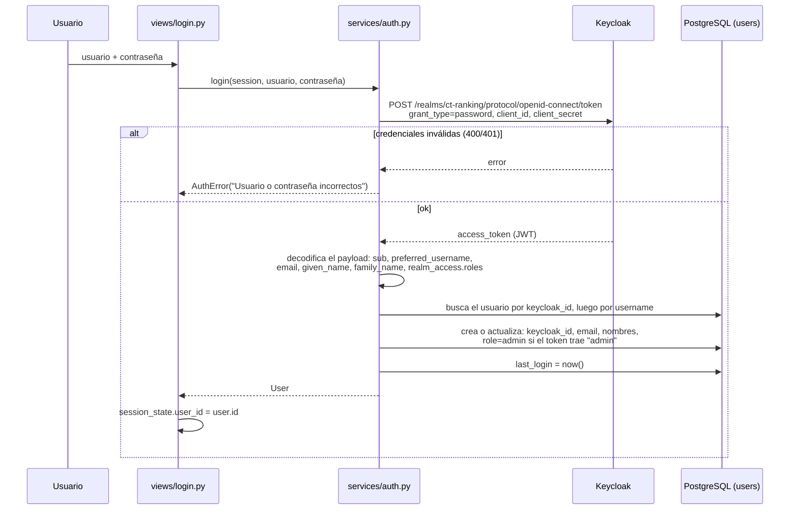

# 5. Autenticación

El enunciado pide un *login básico*, opcionalmente con Keycloak. `app/services/auth.py`
implementa dos proveedores intercambiables con la variable `AUTH_PROVIDER`. Las vistas y el
resto de servicios no saben cuál está activo: siempre llaman a las mismas funciones públicas.

| Función pública | Descripción |
|-----------------|-------------|
| `login(session, username, password, otp=None) -> User` | Valida las credenciales (y el código 2FA en `otp`), sincroniza el usuario local, actualiza `last_login` y verifica que la cuenta esté activa. Acepta usuario **o** correo. Lanza `EmailNotVerifiedError` si la cuenta no se activó. |
| `register(session, *, username, email, password, first_name, last_name, role=student, require_verification=True) -> User` | Valida los datos y verifica que el usuario y el correo sean únicos. Con Keycloak, la cuenta queda pendiente de activación y se envía el enlace al correo. |
| `resend_verification(login)` | Reenvía el enlace de activación. No revela si la cuenta existe. |
| `verify_credentials(user, password, otp=None)` | Re-autenticación para acciones sensibles (eliminar la cuenta, desactivar el 2FA). |
| `change_password(session, user, current, new, otp=None)` | Verifica la contraseña actual (y el código 2FA) y establece la nueva. |
| `change_email(session, user, email)` | Valida el correo, verifica que sea único y lo actualiza. |
| `change_names(session, user, first_name, last_name)` | Actualiza nombre y apellido. |
| `set_active(session, user, active)` | Habilita o deshabilita la cuenta. Lo usa el panel de administrador. |
| `two_factor_supported()`, `two_factor_enabled(user)` | Indica si hay 2FA disponible (sólo con Keycloak) y si el usuario lo tiene activo. |
| `request_two_factor_setup(user)` | Pide a Keycloak que envíe el correo con el enlace para configurar el 2FA (QR). El enlace dura 12 horas. |
| `disable_two_factor(user, password, otp)` | Verifica la contraseña y el código, y borra las credenciales OTP en Keycloak. |

Todas lanzan `AuthError` con un mensaje en español apto para mostrar al usuario.

## Validaciones comunes

| Dato | Regla |
|------|-------|
| Usuario | `^[a-zA-Z0-9_.-]{3,30}$` y único, sin distinguir mayúsculas. |
| Correo | Formato `algo@dominio.tld`. Se guarda en minúsculas y debe ser único. |
| Nombre y apellido | Ambos obligatorios: Keycloak 26 los exige (ver abajo). |
| Contraseña | Mínimo 8 caracteres y máximo 72 bytes (límite de bcrypt). Debe contener letras y números. |

## Proveedor `keycloak` (por defecto)

### Configuración del realm

Keycloak importa el archivo `docker/keycloak/ct-ranking-realm.json` en el primer arranque:

| Elemento | Configuración |
|----------|---------------|
| Realm | `ct-ranking`, `sslRequired: none` (desarrollo), `loginWithEmailAllowed: true`, `duplicateEmailsAllowed: false`, `bruteForceProtected: true`. |
| Roles de realm | `student`, `admin`. |
| Cliente `ct-ranking-app` | Confidencial (`client-secret` = `${KEYCLOAK_CLIENT_SECRET}`), `directAccessGrantsEnabled: true` (login con usuario y contraseña), `serviceAccountsEnabled: true`, `standardFlowEnabled: false`. |
| Cuenta de servicio del cliente | Roles de cliente `realm-management`: `manage-users`, `view-users`, `query-users`. |
| Usuario administrador | `${APP_ADMIN_USERNAME}` con correo y contraseña de `.env`, roles `admin` y `student`, correo verificado. |
| Flujo *direct grant* (por defecto en Keycloak) | Usuario → contraseña → **«Conditional OTP»**: si el usuario tiene 2FA, exige el código en el parámetro `otp`. |
| Protección contra fuerza bruta | Activa. Varios intentos fallidos seguidos bloquean temporalmente la cuenta. |

Lo que depende del entorno no está en el JSON, porque éste sólo se importa la primera vez. Lo
aplica `scripts/configure_keycloak.py` en cada `make up`:

- el servidor **SMTP** del realm (`KEYCLOAK_SMTP_*`, `MAIL_FROM`);
- los idiomas `es` y `en`, con español por defecto;
- `rootUrl`, `redirectUris` y `webOrigins` del cliente, con el valor de `APP_URL`. Así funciona
  «Volver a la aplicación» tras verificar el correo o configurar el 2FA.

### Flujo de login (Resource Owner Password Credentials)

Detalles:

- **Firma del token.** El token se recibe directamente de Keycloak por el canal backend
  (servidor a servidor), así que no se vuelve a verificar su firma. Sólo se decodifica el
  payload para leer los *claims*.
- **Primer login.** Si es la primera vez que el usuario entra y no tiene fila en `users` (por
  ejemplo, se creó a mano en la consola de Keycloak), la fila se crea automáticamente.
- **Cuenta deshabilitada en Keycloak.** Keycloak responde `Account disabled` y la app lo
  traduce a "La cuenta está deshabilitada".

### Operaciones de administración (API Admin de Keycloak)

`KeycloakClient` primero obtiene un token de la cuenta de servicio
(`grant_type=client_credentials`). Con ese token llama a:

| Operación | Endpoint | Cuándo |
|-----------|----------|--------|
| Crear usuario | `POST /admin/realms/ct-ranking/users` (con credencial no temporal) | `register` |
| Restablecer contraseña | `PUT /admin/realms/ct-ranking/users/{id}/reset-password` | `change_password` (después de verificar la contraseña actual con un login) |
| Actualizar usuario | `GET` + `PUT /admin/realms/ct-ranking/users/{id}` | `change_email`, `change_names`, `set_active` |
| Buscar usuario | `GET /admin/realms/ct-ranking/users?username=…&exact=true` (o `email=`) | Reenvío de la activación y diagnóstico de errores de login |
| Enviar enlace de activación | `PUT /admin/realms/ct-ranking/users/{id}/send-verify-email` | `register`, `resend_verification` |
| Enviar enlace de configuración de 2FA | `PUT /admin/realms/ct-ranking/users/{id}/execute-actions-email` con `["CONFIGURE_TOTP"]` | `request_two_factor_setup` |
| Listar o borrar credenciales OTP | `GET /users/{id}/credentials` y `DELETE /users/{id}/credentials/{credId}` | `two_factor_enabled`, `disable_two_factor` |
| Estado de fuerza bruta | `GET /admin/realms/ct-ranking/attack-detection/brute-force/users/{id}` | Mensaje «cuenta bloqueada temporalmente» |
| Borrar usuario | `DELETE /admin/realms/ct-ranking/users/{id}` | Purga de cuentas vencidas |

El `PUT` envía la representación **completa** del usuario, que se obtiene antes con el `GET`.
Con el *user profile* declarativo de Keycloak 24+, un `PUT` parcial puede borrar los
atributos que no se incluyen.

### ¿Por qué nombre y apellido son obligatorios?

Keycloak 26 activa por defecto un *user profile* que exige `firstName` y `lastName`. Si un
usuario no los tiene, Keycloak le asigna la acción requerida `VERIFY_PROFILE`, y el login por
contraseña falla con *"Account is not fully set up"*. Por eso:

- El formulario de registro pide nombre y apellido por separado.
- El modelo guarda `first_name` y `last_name`.
- Ambos se sincronizan con Keycloak.

### ¿Dónde están las contraseñas?

Con este proveedor **la base de datos de la app nunca guarda contraseñas**: `users.password_hash`
queda en `NULL`. Las credenciales viven en la base `keycloak`, cifradas con el algoritmo de hash
de Keycloak. Se gestionan desde la consola: http://localhost:8180 → realm `ct-ranking` → *Users*.

### Activación por correo y 2FA

- **Activación:** al registrarse, la cuenta se crea con `emailVerified=false` y la acción
  requerida `VERIFY_EMAIL`. Hasta abrir el enlace del correo, Keycloak responde
  *«Account is not fully set up»* (sólo si la contraseña es correcta) y la app lo traduce a
  `EmailNotVerifiedError`.
- **2FA:** la configuración (QR) y la validación del código las hace Keycloak.

Ver el detalle completo en
[Cuentas, seguridad y moderación](14-cuentas-seguridad-y-moderacion.md).

## Proveedor `local`

Se activa con `AUTH_PROVIDER=local`. Lo usan las pruebas y sirve cuando no hay Keycloak.

| Operación | Implementación |
|-----------|----------------|
| Login | Busca el usuario por `username` o `email`, sin distinguir mayúsculas, y verifica con `bcrypt.checkpw` contra `users.password_hash`. |
| Registro | `bcrypt.hashpw(password, gensalt())` y se guarda en `password_hash`. |
| Cambio de contraseña | Verifica la actual con bcrypt y guarda el nuevo hash. |
| Correo, nombres, activar | Sólo actualizan la tabla `users`. |
| Administrador | `init_db` crea `APP_ADMIN_USERNAME` con el hash de `APP_ADMIN_PASSWORD` si aún no tiene contraseña. |

## Roles

- `users.role` vale `student` o `admin`. `User.is_admin` es la propiedad que consultan la UI y
  los servicios.
- Un usuario se vuelve `admin` de tres maneras:
  - El token de Keycloak trae el rol de realm `admin`. Se aplica en cada login.
  - Un administrador lo promueve desde *Panel → Usuarios*. La promoción se guarda en la BD de
    la app y se conserva entre logins.
  - `init_db` siempre fuerza `role = admin` para `APP_ADMIN_USERNAME`.
- **Limitación conocida:** degradar desde el panel a un usuario que tiene el rol `admin` *en
  Keycloak* no persiste, porque el siguiente login lo vuelve a promover. Para degradarlo hay que
  quitarle el rol en la consola de Keycloak.

## Sesión en la interfaz

- **Inicio de sesión exitoso:** se guarda `st.session_state["user_id"]`.
- **En cada rerun:** `common.current_user()` recarga el usuario desde la BD. Si ya no existe o
  fue deshabilitado, se borra `user_id` y se vuelve a mostrar el login.
- **Cerrar sesión:** limpia todo `st.session_state`.
- **Recargar el navegador:** crea una sesión nueva de Streamlit, así que hay que volver a
  iniciar sesión. Una mejora futura sería el flujo *Authorization Code* de OIDC con `st.login`
  y cookies.
