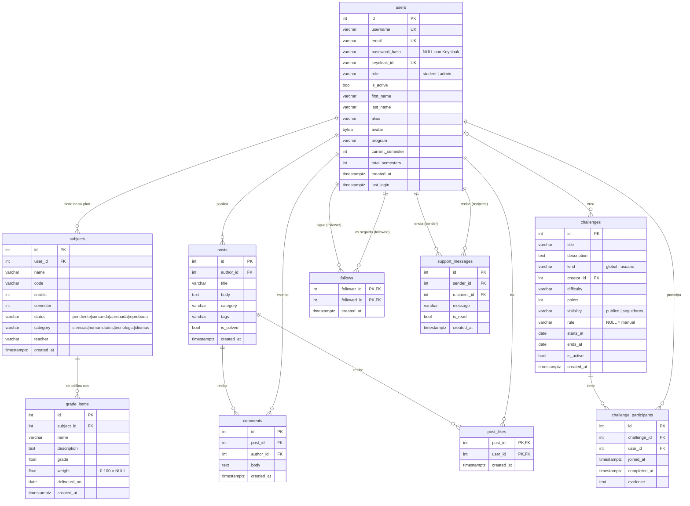

# 6. Modelo de datos

Los modelos están en `app/db/models.py` y usan el estilo declarativo tipado de SQLAlchemy 2.0
(`Mapped[...]`, `mapped_column`). Todas las tablas están en la base `ctranking`, esquema `public`.

## Diagrama entidad-relación

## Enumeraciones

Se definen como `StrEnum` en Python y se guardan como `VARCHAR`. No se usan tipos `ENUM` de
PostgreSQL, así que agregar un valor no requiere migración. Los servicios validan los valores.

| Enum | Valores | Columna |
|------|---------|---------|
| `Role` | `student`, `admin` | `users.role` |
| `SubjectStatus` | `pendiente`, `cursando`, `aprobada`, `reprobada` | `subjects.status` |
| `SubjectCategory` | `ciencias`, `humanidades`, `tecnologia`, `idiomas` | `subjects.category` |
| `ChallengeKind` | `global`, `usuario` | `challenges.kind` |
| `Visibility` | `publico`, `seguidores` | `challenges.visibility` |
| `Difficulty` | `facil`, `media`, `dificil` | `challenges.difficulty` |

Las categorías de foro (`posts.category`) no son un enum de base de datos. Son una lista en
`app/services/forum.py` (`CATEGORIES`): General, Duda académica, Problemática, Proyecto, Recursos y
Vida universitaria.

## Tablas

> **Convenciones**
> - Todos los `id` son `INTEGER` autoincrementales (`SERIAL`/identidad).
> - Las fechas y horas son `TIMESTAMP WITH TIME ZONE` y se guardan en UTC (`datetime.now(UTC)`).
> - Los valores por defecto se aplican **desde Python** (`default=` de SQLAlchemy), no como
>   `DEFAULT` en el DDL. Si insertas filas con SQL directo, debes dar todos los valores.
> - Las cadenas "opcionales" usan `''` en lugar de `NULL` (columnas `NOT NULL` con default
>   `""`). Sólo son `NULL` las columnas tipadas como `X | None`.

### `users`: usuarios y perfil

| Columna | Tipo | Nulo | Default | Descripción |
|---------|------|------|---------|-------------|
| `id` | integer | no | serial | PK. |
| `username` | varchar(50) | no | — | Único (índice `ix_users_username`). |
| `email` | varchar(255) | no | — | Único (índice `ix_users_email`). Se guarda en minúsculas. |
| `password_hash` | varchar(255) | sí | — | Hash bcrypt (sólo con `AUTH_PROVIDER=local`). |
| `keycloak_id` | varchar(64) | sí | — | `sub` del usuario en Keycloak. Único. |
| `role` | varchar(20) | no | `student` | `student` / `admin`. |
| `is_active` | boolean | no | `true` | Cuenta habilitada. |
| `first_name`, `last_name` | varchar(80) | no | `''` | Nombre y apellido. |
| `alias` | varchar(50) | no | `''` | Nombre visible. Único sin distinguir mayúsculas (validado en el servicio). |
| `bio` | text | no | `''` | Biografía (máx. 1000 caracteres, validado). |
| `avatar` | bytea | sí | — | Foto de perfil en PNG de 256×256 ya procesada. |
| `avatar_mime` | varchar(50) | sí | — | Siempre `image/png` cuando hay foto. |
| `phone`, `city`, `university`, `student_code`, `interests`, `github_url`, `linkedin_url` | varchar | no | `''` | Datos adicionales del perfil. |
| `birth_date` | date | sí | — | No puede estar en el futuro. |
| `program` | varchar(150) | no | `''` | Programa o carrera. |
| `study_plan` | varchar(150) | no | `''` | Nombre o versión del pensum. |
| `current_semester` | integer | no | `1` | Semestre actual (1 a 20, ≤ total). |
| `total_semesters` | integer | no | `10` | Semestres del plan. Cargar un pensum lo ajusta. |
| `created_at` | timestamptz | no | ahora | Fecha de registro. |
| `last_login` | timestamptz | sí | — | Se actualiza en cada login. Se usa para "activos en 7 días". |

Propiedades calculadas (no son columnas): `full_name`, `display_name` (alias, luego nombre
completo, luego username) e `is_admin`.

### `subjects`: materias del plan de un estudiante

| Columna | Tipo | Nulo | Default | Descripción |
|---------|------|------|---------|-------------|
| `id` | integer | no | serial | PK. |
| `user_id` | integer | no | — | FK → `users.id` `ON DELETE CASCADE`. Índice. |
| `name` | varchar(150) | no | — | Nombre de la materia. |
| `code` | varchar(30) | no | `''` | Código. Los del pensum son `IS<semestre><nn>`, p. ej. `IS305`. |
| `credits` | integer | no | `3` | ≥ 0. |
| `semester` | integer | no | `1` | ≥ 1. Semestre en el que se cursa o se planea. |
| `status` | varchar(20) | no | `cursando` | Ver `SubjectStatus`. |
| `category` | varchar(20) | no | `tecnologia` | Ver `SubjectCategory`. |
| `teacher` | varchar(150) | no | `''` | Docente. |
| `created_at` | timestamptz | no | ahora | |

Una materia **repetida** (reprobada y vuelta a cursar) son **dos filas**: la reprobada en su
semestre original y la nueva en el semestre en que se repite. Las dos comparten `code`/`name`,
y el avance de créditos las cuenta una sola vez (ver
[reglas](10-reglas-de-negocio.md#avance-de-créditos-por-categoría)).

### `grade_items`: ítems calificables

| Columna | Tipo | Nulo | Default | Descripción |
|---------|------|------|---------|-------------|
| `id` | integer | no | serial | PK. |
| `subject_id` | integer | no | — | FK → `subjects.id` `ON DELETE CASCADE`. Índice. |
| `name` | varchar(150) | no | — | P. ej. "Parcial 1". |
| `description` | text | no | `''` | |
| `grade` | float | no | — | Entre `GRADE_MIN` y `GRADE_MAX` (validado en el servicio). |
| `weight` | float | sí | — | Porcentaje sobre la nota final. `CHECK ck_item_weight`: `NULL` o 0–100. La suma por materia no puede superar 100 (validado). |
| `delivered_on` | date | sí | — | Fecha de entrega. |
| `created_at` | timestamptz | no | ahora | |

### `posts`: publicaciones del foro

| Columna | Tipo | Nulo | Default | Descripción |
|---------|------|------|---------|-------------|
| `id` | integer | no | serial | PK. |
| `author_id` | integer | no | — | FK → `users.id` CASCADE. Índice. |
| `title` | varchar(200) | no | — | 5 a 200 caracteres. |
| `body` | text | no | — | Markdown. |
| `category` | varchar(50) | no | `General` | Una de `forum.CATEGORIES`. |
| `tags` | varchar(200) | no | `''` | Etiquetas separadas por coma, en minúsculas. |
| `is_solved` | boolean | no | `false` | Marcada como resuelta por el autor. |
| `created_at` | timestamptz | no | ahora | |

### `comments`: comentarios de publicaciones

| Columna | Tipo | Nulo | Descripción |
|---------|------|------|-------------|
| `id` | integer | no | PK. |
| `post_id` | integer | no | FK → `posts.id` CASCADE. Índice. |
| `author_id` | integer | no | FK → `users.id` CASCADE. Índice. |
| `body` | text | no | 1 a 5000 caracteres. |
| `created_at` | timestamptz | no | Orden de presentación. |

### `post_likes`: "me gusta"

PK compuesta `(post_id, user_id)`: un usuario sólo puede dar un "me gusta" por publicación. Ambas
columnas son FK con CASCADE. Tiene además `created_at`.

### `challenges`: retos

| Columna | Tipo | Nulo | Default | Descripción |
|---------|------|------|---------|-------------|
| `id` | integer | no | serial | PK. |
| `title` | varchar(200) | no | — | ≥ 5 caracteres. |
| `description` | text | no | — | |
| `kind` | varchar(20) | no | `usuario` | `global` (sólo lo crea un admin) o `usuario`. |
| `creator_id` | integer | sí | — | FK → `users.id` CASCADE. Los retos globales de `init_db` quedan a nombre del admin. |
| `difficulty` | varchar(20) | no | `media` | `facil` / `media` / `dificil`. |
| `points` | integer | no | `10` | 1 a 100. |
| `visibility` | varchar(20) | no | `publico` | `publico` / `seguidores`. Los globales siempre son `publico`. |
| `rule` | varchar(50) | sí | — | Código de regla automática. `NULL` = verificación manual con evidencia. |
| `starts_at`, `ends_at` | date | sí | — | Ventana en la que el reto está abierto. |
| `is_active` | boolean | no | `true` | El creador o un admin pueden cerrarlo o reabrirlo. |
| `created_at` | timestamptz | no | ahora | |

### `challenge_participants`: participación en retos

| Columna | Tipo | Nulo | Descripción |
|---------|------|------|-------------|
| `id` | integer | no | PK. |
| `challenge_id` | integer | no | FK → `challenges.id` CASCADE. Índice. |
| `user_id` | integer | no | FK → `users.id` CASCADE. Índice. |
| `joined_at` | timestamptz | no | Momento en que se unió. |
| `completed_at` | timestamptz | sí | Momento en que lo completó. `NULL` = en progreso. Determina el orden del ranking. |
| `evidence` | text | no | Evidencia aportada o "Verificado automáticamente". |

Restricción `uq_participant UNIQUE (challenge_id, user_id)`.

### `follows`: relaciones de seguimiento

PK compuesta `(follower_id, followed_id)`, ambas FK → `users.id` CASCADE, más `created_at`.
`CHECK ck_no_self_follow (follower_id <> followed_id)` impide seguirse a sí mismo.

### `support_messages`: mensajes de apoyo

| Columna | Tipo | Nulo | Default | Descripción |
|---------|------|------|---------|-------------|
| `id` | integer | no | serial | PK. |
| `sender_id` | integer | no | — | FK → `users.id` CASCADE. Índice. |
| `recipient_id` | integer | no | — | FK → `users.id` CASCADE. Índice. |
| `message` | varchar(500) | no | — | 1 a 500 caracteres. |
| `is_read` | boolean | no | `false` | Se marca al abrir la bandeja. |
| `created_at` | timestamptz | no | ahora | |

## Índices y restricciones

| Nombre | Tabla | Tipo |
|--------|-------|------|
| `ix_users_username`, `ix_users_email` | users | únicos |
| `users_keycloak_id_key` | users | único |
| `ix_subjects_user_id` | subjects | índice |
| `ix_grade_items_subject_id` | grade_items | índice |
| `ix_posts_author_id` | posts | índice |
| `ix_comments_post_id`, `ix_comments_author_id` | comments | índices |
| `ix_challenge_participants_challenge_id`, `…_user_id` | challenge_participants | índices |
| `uq_participant` | challenge_participants | único compuesto |
| `ix_support_messages_sender_id`, `…_recipient_id` | support_messages | índices |
| `ck_item_weight` | grade_items | CHECK |
| `ck_no_self_follow` | follows | CHECK |

## Borrado en cascada

Todas las claves foráneas tienen `ON DELETE CASCADE`. Además, varias relaciones ORM declaran
`cascade="all, delete-orphan"`. El efecto de cada borrado:

| Se borra | También se borran |
|----------|-------------------|
| Un usuario | Sus materias (y sus ítems), publicaciones, comentarios, "me gusta", retos creados (con sus participaciones), participaciones, relaciones de seguimiento y mensajes enviados y recibidos. |
| Una materia | Sus ítems calificables. |
| Una publicación | Sus comentarios y "me gusta". |
| Un reto | Sus participaciones (y con ellas el ranking del reto). |

## Base de datos de Keycloak

La base `keycloak` la gestiona Keycloak por completo; la aplicación nunca la consulta
directamente. Guarda los realms, clientes, usuarios, credenciales con hash, roles y sesiones.
El único vínculo con la base de la app es `users.keycloak_id`, que corresponde al `id` (`sub`)
del usuario en Keycloak.
