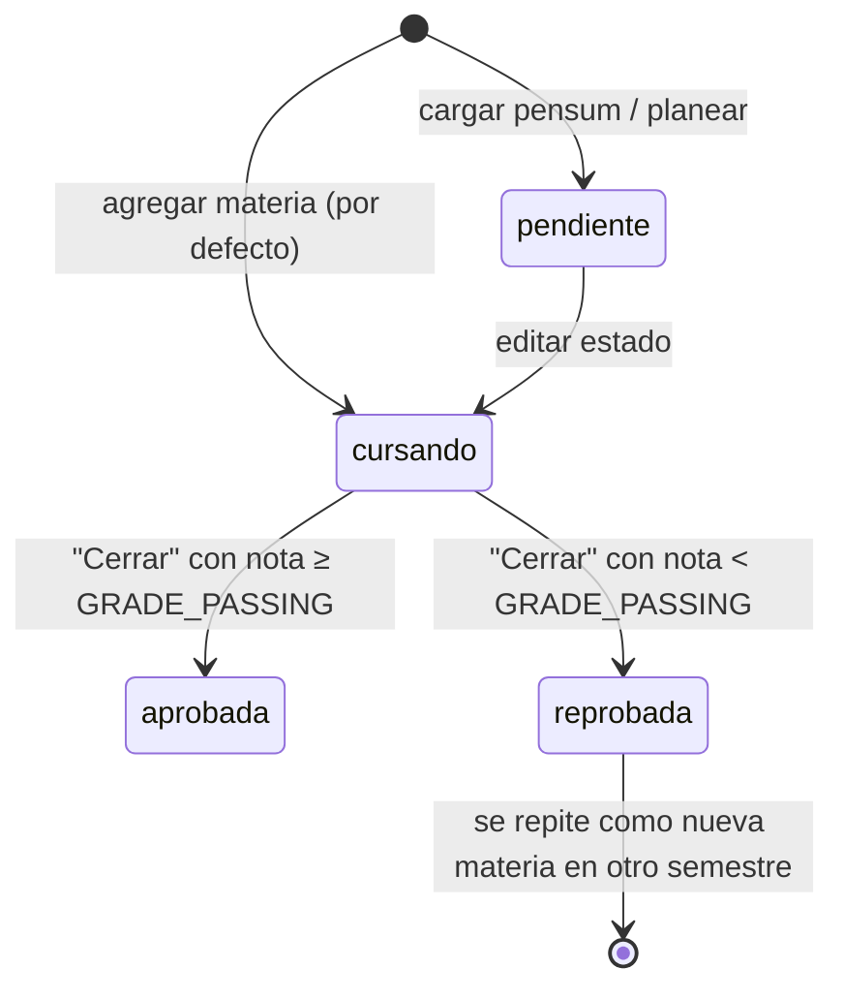
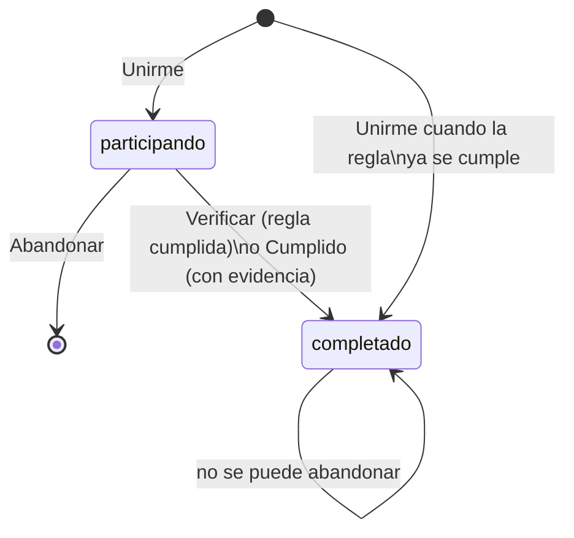

# 10. Reglas de negocio y cálculos

Todos los cálculos se hacen **al vuelo** a partir de las tablas base. Promedios, créditos,
rankings y puntos **no se guardan**, así que siempre reflejan los datos actuales.

## Escala de calificaciones

La escala se configura en `.env`:

| Variable | Defecto | Uso |
|----------|---------|-----|
| `GRADE_MIN` | 0 | Nota mínima permitida para un ítem. |
| `GRADE_MAX` | 5 | Nota máxima. También define la meta del reto "Excelencia académica" (80 % de la escala). |
| `GRADE_PASSING` | 3 | Nota mínima aprobatoria. Sirve para sugerir el estado al cerrar una materia, colorear las notas y marcar a los estudiantes en riesgo. |

## Nota de una materia

Sea una materia con ítems de nota *gᵢ* y porcentaje *wᵢ*:

- **Si todos los ítems tienen porcentaje > 0**, la nota es el promedio ponderado normalizado por
  los porcentajes registrados (la "nota acumulada"):

  ```
  nota = Σ(gᵢ · wᵢ) / Σ(wᵢ)
  ```

  Ejemplo: Parcial 1 = 5,0 (30 %) y Parcial 2 = 2,5 (20 %). La nota es
  (1,5 + 0,5) / 0,5 = **4,0**, con un 50 % evaluado.

- **En otro caso**, si algún ítem no tiene porcentaje, se usa el promedio simple:
  `nota = Σ gᵢ / n`.
- **Sin ítems**, la materia no tiene nota (`—`) y no cuenta en los promedios.

Otras reglas de los ítems:

- **Porcentaje evaluado:** `min(100, Σ wᵢ)`. Se muestra en la tarjeta de la materia.
- **Suma de porcentajes:** la suma de porcentajes de una materia no puede superar 100. Se
  valida al agregar y al editar.

## Promedio de un semestre

Es el promedio **ponderado por créditos** de las materias de ese semestre que tienen nota y cuyo
estado es `cursando`, `aprobada` o `reprobada`:

```
promedio_semestre = Σ(nota_materia · créditos) / Σ(créditos)
```

Las materias con 0 créditos cuentan con peso 1. Las materias `pendiente` no cuentan.

## Promedio general (acumulado)

Usa la misma fórmula sobre **todas** las materias vistas, de todos los semestres, que tengan
nota. Incluye las reprobadas y las del semestre en curso con notas parciales. Si una materia se
repitió, los dos intentos cuentan, como en un promedio acumulado tradicional.

## Avance de créditos por categoría

Es la gráfica de "Historia académica" y del detalle de estudiante del panel. Se calcula con
`academics.credit_progress`:

1. **Unificación de materias repetidas.**
   - Las materias se agrupan por clave: `código`, o `nombre` si no hay código, sin distinguir
     mayúsculas.
   - Si la misma materia aparece varias veces, se toma su **mejor estado**:
     aprobada > cursando > reprobada/pendiente.
   - Así, una materia reprobada y luego aprobada suma sus créditos **una sola vez** al total y
     al avance.
2. **Créditos por categoría.** Para cada categoría (ciencias, humanidades, tecnología, idiomas),
   y para el total:
   - `total`: créditos de todas las materias del plan, incluidas las pendientes.
   - `aprobados`: créditos de las materias en estado `aprobada`.
   - `cursando`: créditos de las materias en estado `cursando`.
3. **Porcentajes.** La gráfica los muestra respecto al total de la categoría:
   - Azul claro: `aprobados / total`.
   - Gris: `cursando / total`.
   - El resto es lo que falta por cursar.

> El total depende de las materias **registradas** en el plan. Para que represente toda la
> carrera, carga el pensum completo ("Cargar pensum") o registra todas las materias como
> "Pendiente". Por ejemplo, en Ingeniería de Software el total es 148 créditos.

## Estados de las materias



Cualquier estado se puede cambiar a mano con **Editar**. El botón **Cerrar** sólo sugiere el
estado a partir de la nota.

## Estudiantes en riesgo

Un estudiante está **en riesgo** si:

```
promedio_general < GRADE_PASSING   o   promedio_semestre_actual < GRADE_PASSING
```

Sólo cuenta cuando esos promedios existen. El panel de administrador lo marca en la tabla de
riesgo, en el detalle del estudiante (alerta roja) y en la gráfica de grupos (barras rojas).

## Retos

### Visibilidad

Un estudiante ve un reto si se cumple alguna de estas condiciones:

- es **global**;
- es de la comunidad y **público**;
- él lo **creó**;
- es "sólo seguidores" y él **sigue al creador**.

Los administradores ven todos los retos.

### Estado abierto

Un reto está abierto si `is_active` es verdadero y la fecha de hoy está dentro de
`[starts_at, ends_at]`, cuando esas fechas existen. Sólo es posible **unirse** o **completar** un
reto abierto.

### Ciclo de participación



- **Retos con regla (automáticos):**
  - La regla mide la **historia completa** del usuario. Por eso un usuario antiguo que ya
    cumple la condición lo completa en el momento de unirse. Así los retos globales son
    equivalentes para usuarios nuevos y antiguos.
  - Los retos automáticos se re-evalúan cada vez que el usuario abre **Inicio** o **Retos**
    (`refresh_automatic`), o cuando pulsa **Verificar**.
- **Retos manuales:** exigen un texto de evidencia (descripción o enlace).

### Ranking de un reto

1. Primero los que lo **completaron**, ordenados por `completed_at` ascendente. Reciben la
   posición 1, 2, 3…
2. Después los que siguen **en progreso**, ordenados por `joined_at`, sin posición.
3. **Primero en cumplirlo:** el participante con el `completed_at` más antiguo.
4. **Tasa de éxito:** `completados / participantes`.

### Puntaje (leaderboard)

```
puntaje(usuario) = Σ puntos de los retos completados
                 + Σ ceil(puntos × 0,5) de los retos en los que fue el primero en completar
```

En caso de empate, el orden es: mayor puntaje, luego más veces primero, luego `username`
alfabético. Existen tres variantes:

- **General:** todos los usuarios.
- **Entre amigos:** las personas que sigo, más yo.
- **De grupo:** los usuarios filtrados en el panel de administrador.

El bonus se calcula considerando a **todos** los participantes del reto. Si el ganador real no
está en el grupo filtrado, nadie del grupo recibe ese bonus.

## Foros

- **Gestión de una publicación:** sólo el autor o un admin pueden marcarla como resuelta,
  reabrirla o eliminarla.
- **Gestión de un comentario:** sólo su autor o un admin pueden eliminarlo.
- **"Me gusta":** uno por usuario y publicación, garantizado por la PK compuesta. Se alterna con
  `toggle_like`.

## Social

- No es posible seguirse a sí mismo ni enviarse mensajes a sí mismo. Lo validan los servicios,
  y en el caso de los seguimientos también un `CHECK` en la BD.
- Seguir a alguien es idempotente.
- Los mensajes de apoyo se marcan como leídos al abrir la bandeja.

## Cuentas

| Regla | Valor |
|-------|-------|
| Activación de la cuenta (Keycloak) | Obligatoria con el enlace del correo antes del primer login. |
| Código para eliminar la cuenta | 6 dígitos, válido **15 minutos**, máximo **5 intentos**. Pedir uno nuevo invalida el anterior. |
| Plazo de eliminación | `ACCOUNT_DELETION_DAYS` (7 por defecto) desde la confirmación. |
| Cuenta con eliminación programada | Oculta para los demás (perfil, contenido, mensajes, rankings). Al iniciar sesión sólo puede cancelar. |
| Purga | Al vencer el plazo, se borra en Keycloak y en la app, con todo su contenido en cascada. |
| 2FA (Keycloak) | TOTP de 6 dígitos cada 30 s. Un código no se puede reutilizar. Se pide en el login, al cambiar la contraseña, al pedir la eliminación y al desactivar el 2FA. |
| Fuerza bruta (Keycloak) | Varios intentos fallidos en poco tiempo bloquean temporalmente la cuenta. |

## Bloqueos y reportes

- **Bloquear:**
  - Es unilateral al crearse, pero sus efectos son **bidireccionales**.
  - Al bloquear se borran los seguimientos mutuos.
  - Mientras dure el bloqueo no se puede seguir ni enviar mensajes de apoyo en ningún sentido.
- **Contenido oculto para quien mira** (`hidden_user_ids`): bloqueos en ambas direcciones +
  cuentas en eliminación. El conteo de comentarios en la lista del foro incluye los comentarios
  ocultos.
- **Reportar:**
  - No se puede reportar a uno mismo.
  - Si el motivo es «otro», la descripción es obligatoria.
  - No se puede repetir un reporte pendiente idéntico.
- **Cerrar un reporte:** sólo los administradores lo resuelven o descartan, y queda registrado
  quién y cuándo lo hizo.
