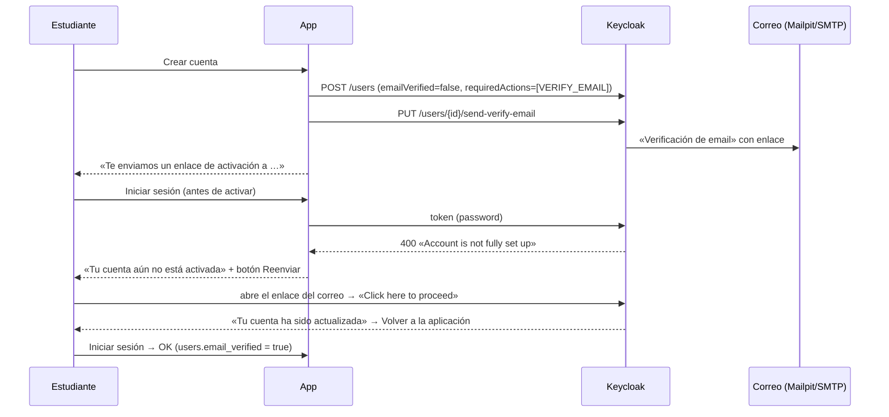
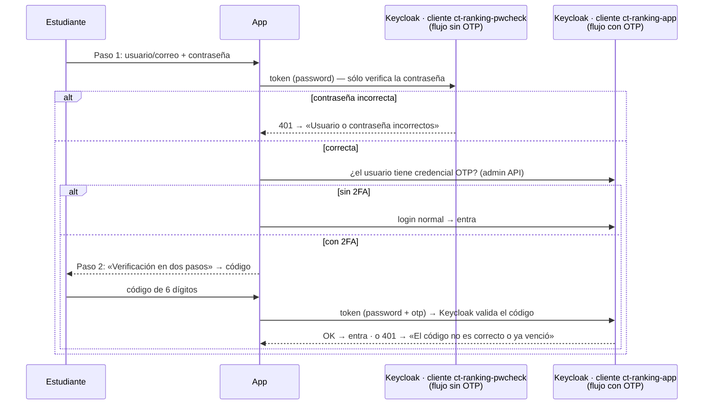
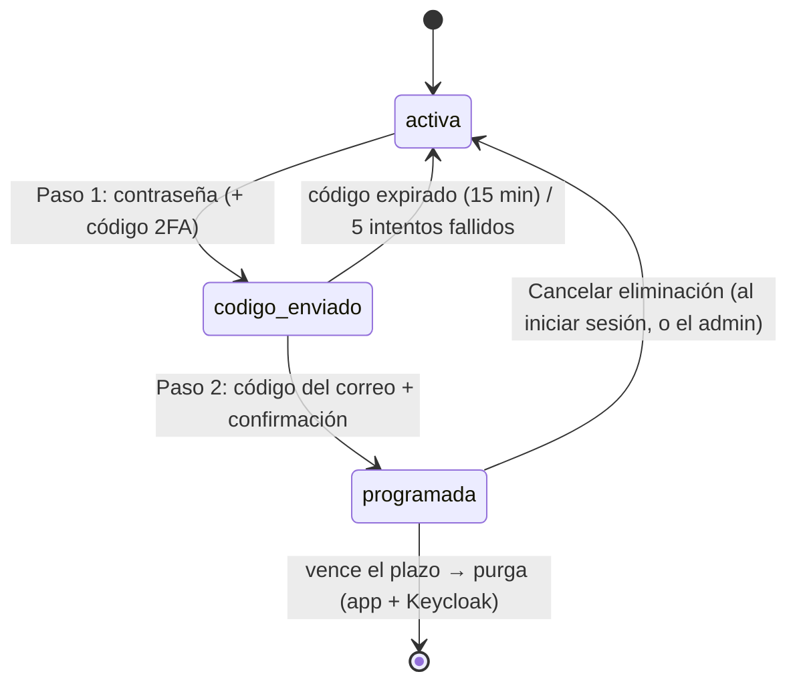

# 14. Cuentas, seguridad y moderación

Esta guía cubre la activación de cuentas por correo, la verificación en dos pasos (2FA), la
eliminación diferida de cuentas, y los reportes y bloqueos entre usuarios.

## Qué ofrece Keycloak y qué implementa la app

Revisado en el realm `ct-ranking` (Keycloak 26.4):

| Necesidad | ¿Lo da Keycloak? | Cómo se resolvió |
|-----------|------------------|------------------|
| Activar la cuenta por correo | ✅ Sí, con un **enlace** (acción requerida `VERIFY_EMAIL`) | La cuenta se crea pendiente de verificación y Keycloak envía el enlace. Un **código** por correo no es nativo en Keycloak, así que se eligió el enlace. |
| 2FA con QR (TOTP) | ✅ Sí, **sin servicios externos** (`CONFIGURE_TOTP`, política TOTP de 6 dígitos cada 30 s, HmacSHA1) | Keycloak muestra el QR en su página y valida el código en cada login. Compatible con Google Authenticator, Microsoft Authenticator y FreeOTP. |
| Exigir el código al iniciar sesión | ✅ Sí: el flujo *direct grant* del realm incluye **«Conditional OTP»** | La app envía el código en el parámetro `otp` del login. Para pedir el código sólo después de una contraseña correcta, se agrega un cliente con un flujo sin OTP (ver abajo). |
| Otras opciones de Keycloak (no usadas) | Códigos de recuperación (`CONFIGURE_RECOVERY_AUTHN_CODES`), llaves de seguridad y passkeys (WebAuthn) | Se pueden habilitar más adelante. Requieren el flujo de login del navegador. |
| Eliminar la cuenta | ⚠️ Keycloak tiene `delete_account`, pero **borra al instante** | La espera de 7 días, la doble verificación y la cancelación son lógica de la app. Al vencer el plazo, la app borra al usuario también en Keycloak. |
| Enviar correos | ❌ Necesita un **servidor SMTP** | En desarrollo, **Mailpit** (contenedor). En producción, cualquier SMTP real. |
| Reportar y bloquear usuarios | ❌ No aplica (es lógica de la plataforma) | Tablas `user_reports` y `user_blocks`, y pestaña **Reportes** en el panel de administración. |

## Correo: Mailpit y SMTP

Hay dos emisores de correo. Ambos usan el mismo servidor SMTP:

| Emisor | Correos | Configuración |
|--------|---------|---------------|
| **Keycloak** | Verificación de cuenta («Verificación de email») y configuración del 2FA («Actualiza tu cuenta») | SMTP del realm, que aplica `scripts/configure_keycloak.py` en cada `make up`. Usa `KEYCLOAK_SMTP_HOST` y `KEYCLOAK_SMTP_PORT`, con valor por defecto `mailpit:1025` dentro de la red de compose. |
| **La app** (`app/core/mailer.py`) | Código para eliminar la cuenta, aviso de eliminación programada, aviso de cancelación, código para confirmar un correo nuevo y aviso de cambio de correo | `SMTP_HOST`, `SMTP_PORT`, `SMTP_USER`, `SMTP_PASSWORD`, `SMTP_STARTTLS`, `MAIL_FROM`, `MAIL_FROM_NAME`. Por defecto `mailpit:1025` (el contenedor de Mailpit, visto desde el de la app). |

**En desarrollo**, Mailpit (`axllent/mailpit:v1.31.3`) atrapa todos los correos sin enviarlos a
nadie. Para verlos, abre **http://localhost:8025**. Sus enlaces (activación y 2FA) funcionan
normalmente.

**En producción**, cambia en `.env` las variables `SMTP_*` y `KEYCLOAK_SMTP_*` por las de tu
proveedor. Por ejemplo, Gmail con contraseña de aplicación: `smtp.gmail.com:587`,
`SMTP_STARTTLS=true`. Luego ejecuta `make up` para que Keycloak tome la nueva configuración.

`MAIL_BACKEND=memory` guarda los correos en `mailer.OUTBOX` en lugar de enviarlos. Lo usan las
pruebas.

## Correo institucional obligatorio

Los estudiantes deben usar el correo de **`@estudiantes.areandina.edu.co`** (configurable con
`STUDENT_EMAIL_DOMAIN`):

- **En el formulario** de registro y en *Mi perfil → Cuenta y seguridad* sólo se escribe la
  parte antes de la @. El dominio se muestra fijo al lado. Si se escribe una @ o caracteres no
  válidos, aparece un error.
- **En el servicio**, `auth.register`, `auth.validate_new_email` (cambio de correo) y
  `auth.login_with_oidc` rechazan cualquier otro dominio (incluidos otros subdominios como
  `@areandina.edu.co`). Así la regla no se puede saltar aunque se llame al servicio desde otro
  lugar.
- **Administradores:** están exentos, también al entrar con Google. El admin conserva
  `APP_ADMIN_EMAIL`.
- **Usuarios existentes:** `make migrate-emails` cambia su correo a
  `<usuario>@estudiantes.areandina.edu.co` en la app y en Keycloak. `ARGS=--dry-run` muestra los
  cambios sin aplicarlos. Es idempotente.
- **Pruebas y datos demo:** usan ese dominio.

## Activación de la cuenta por correo



- **Cuándo aparece el aviso.** «Account is not fully set up» sólo aparece si la contraseña es
  correcta. Por eso el aviso de cuenta sin activar no revela nada a quien no conoce la
  contraseña.
- **Reenviar el enlace.** Hay dos formas: el botón que aparece tras el intento de login, o el
  expander «¿No recibiste el correo de activación?». La respuesta es siempre la misma, exista o
  no la cuenta, para no revelar qué cuentas existen. Se permite un reenvío por minuto para cada
  usuario o correo escrito (el límite no depende de si la cuenta existe).
- **Mientras no se activa:** el usuario no aparece en la búsqueda de Personas
  (`users.email_verified = false`).
- **Si falla el envío del correo durante el registro:** la cuenta se crea igual, y el enlace se
  puede reenviar después.
- **Excepciones:**
  - Las cuentas **demo** se crean ya activadas (`require_verification=False`).
  - Con `AUTH_PROVIDER=local` no hay activación: la cuenta queda activa de inmediato.

## Verificación en dos pasos (2FA con QR)

### Activación

1. **Mi perfil → Cuenta y seguridad → «Enviar enlace de configuración».** La app llama a
   `PUT /users/{id}/execute-actions-email` con `["CONFIGURE_TOTP"]`. El enlace es válido por
   12 horas. Se puede pedir un enlace por minuto.
2. **El estudiante abre el correo «Actualiza tu cuenta» → «Click here to proceed».** Keycloak
   muestra el **código QR**, y también la clave en texto si no se puede escanear.
3. **Escanea el QR con su app autenticadora** y escribe en esa página el código de 6 dígitos para
   confirmar. Puede ponerle un nombre al dispositivo (por ejemplo, «Celular»).
4. **Desde entonces, al iniciar sesión**, tras escribir usuario y contraseña, la app le pide el
   **código de verificación**.

### Inicio de sesión con 2FA

El login tiene **dos pasos**, y el código sólo se pide cuando hace falta:



- **Por qué hay un segundo cliente.** El flujo *direct grant* del realm responde **lo mismo**
  ante una contraseña incorrecta y ante un código faltante.
  - Por eso `scripts/configure_keycloak.py` crea el flujo **«direct grant - solo contraseña»**:
    una copia sin el paso *Conditional OTP*.
  - Ese flujo lo usa el cliente **`ct-ranking-pwcheck`**, cuyos tokens duran 60 s y se descartan.
  - Como ese flujo no exige el código, sus tokens **no sirven para nada más**: el cliente tiene
    `fullScopeAllowed: false` y sólo el client scope `basic`, así que el token no lleva roles
    ni audiencia y la API de cuenta de Keycloak lo rechaza (401). `configure_keycloak.py` lo
    aplica en cada `make up`.
  - En producción, cambia `KEYCLOAK_PWCHECK_CLIENT_SECRET` (y el resto de secretos de ejemplo).
  - El ingreso real (paso 2) siempre pasa por el cliente principal, donde **Keycloak valida el
    código**.
- **Datos entre pasos.** Entre el paso 1 y el 2, el usuario y la contraseña quedan sólo en la
  memoria de la sesión del servidor (`st.session_state`), como máximo **5 minutos**. Se borran
  al entrar, al pulsar «Volver» o al vencer el plazo. No hay alternativa con el flujo *direct
  grant*: Keycloak valida contraseña y código en la misma petición.
- **Mensajes:** «Usuario o contraseña incorrectos» (paso 1) y «El código no es correcto o ya
  venció» (paso 2).
- La única excepción es el bloqueo temporal por **fuerza bruta**. Ese estado se consulta aparte
  (`GET /attack-detection/brute-force/users/{id}`) y se muestra un mensaje claro: «espera un
  minuto».
- Un código ya usado **no se puede reutilizar** dentro de su ventana de 30 s.

### Acciones que piden el código

Cambiar la contraseña y solicitar la eliminación de la cuenta vuelven a validar la contraseña con
Keycloak. Si el usuario tiene 2FA, también piden el código.

### Desactivación

En *Cuenta y seguridad → Desactivar 2FA* se piden la contraseña y el código actual. Después la app
borra las credenciales OTP del usuario (`DELETE /users/{id}/credentials/{credentialId}`).

### Si el estudiante pierde el celular

Un administrador entra a la consola de Keycloak (http://localhost:8180 → realm `ct-ranking` →
*Users* → usuario → *Credentials*) y elimina la credencial **OTP**. El estudiante vuelve a entrar
sólo con su contraseña y puede activar el 2FA de nuevo.

## Eliminación de la cuenta (diferida 7 días)



1. **Paso 1: verificación de identidad.**
   - Se piden la contraseña y el código 2FA si lo tiene. Se validan con un login contra Keycloak.
   - Se invalidan los códigos anteriores y se envía un **código de 6 dígitos** al correo,
     válido **15 minutos**.
   - El código se guarda como `HMAC-SHA256(código, APP_SECRET_KEY)` en `verification_codes`,
     nunca en claro. Define `APP_SECRET_KEY` en producción; si está vacía se usa el secreto del
     cliente de Keycloak (aceptable sólo en desarrollo).
   - Entre dos códigos debe pasar al menos **un minuto**, para que nadie pueda llenar el buzón
     del estudiante.
2. **Paso 2: confirmación.**
   - El usuario escribe el código y marca «Entiendo que…».
   - Hay un máximo de **5 intentos** por código. Cada intento fallido se guarda aunque la acción
     termine en error (`InvalidCodeError` hereda de `CommitBeforeRaiseError`), así el límite se
     cumple de verdad.
   - Al confirmar, la eliminación queda programada para dentro de `ACCOUNT_DELETION_DAYS` días
     (`users.deletion_scheduled_for`), se envía un correo con la fecha y **se cierra la sesión**.
3. **Durante el plazo, la cuenta está desactivada:**
   - Su perfil, publicaciones, comentarios, retos creados, mensajes y posiciones en los rankings
     **dejan de verse** para los demás.
   - Si inicia sesión, **sólo** ve la pantalla «Tu cuenta será eliminada» con **Cancelar
     eliminación**. Un administrador también puede cancelarla desde *Panel → Usuarios*.
4. **Al vencer el plazo, la purga:**
   - `purge_due_accounts` borra al usuario en la app y en **Keycloak**, cada cuenta en un
     *savepoint*: si Keycloak falla, esa cuenta se revierte y se reintenta en la siguiente
     ejecución, sin afectar a las demás.
   - Se borran sus retos de la comunidad y, con las claves foráneas en `ON DELETE CASCADE`, el
     resto de su contenido. Los **retos globales** que hubiera creado (p. ej. un admin) se
     conservan con `creator_id = NULL`, para no quitarles los puntos a los demás.
   - Se ejecuta de dos formas:
     - un **hilo en segundo plano** que la app inicia una vez por proceso y que corre cada hora
       (`app/jobs/purge_accounts.py`);
     - `make purge-accounts`, para cron o para ejecutarlo a mano.

Ejemplo de cron para producción:

```cron
15 3 * * * cd /ruta/ct-ranking-platform && make purge-accounts
```

## Cambio de correo (verificado)

El correo sólo cambia cuando se demuestra que se controla el nuevo:

1. *Mi perfil → Cuenta y seguridad → Cambiar correo.* `accounts.request_email_change` valida el
   correo (dominio institucional, distinto del actual y libre) y envía un **código de 6 dígitos**
   a la dirección **nueva**. Mismas reglas que el código de eliminación: 15 minutos, 5 intentos,
   un código por minuto.
2. El estudiante escribe el código. `accounts.confirm_email_change` vuelve a comprobar que el
   correo siga libre, lo guarda (en Keycloak con `emailVerified=true`) y envía un aviso al correo
   **anterior**.

Así nadie puede apropiarse del correo institucional de un compañero que aún no se registró.

## Límites de intentos

| Acción | Límite | Dónde |
|--------|--------|-------|
| Código de eliminación o de cambio de correo | 5 intentos por código; 1 código por minuto | `auth/accounts.py` (en la BD) |
| Reenviar la activación / enlace del 2FA | 1 correo por minuto | `core/ratelimit.py` (memoria) |
| Login local (`AUTH_PROVIDER=local`) | 5 fallos seguidos → 5 minutos de bloqueo | `core/ratelimit.py` (memoria) |
| Login con Keycloak | Protección contra fuerza bruta del realm | Keycloak |

## Bloquear usuarios

- **Dónde:**
  - Menú **«Más» → Bloquear** en Personas (búsqueda, seguidores, perfil público) y en Mensajes
    de apoyo.
  - Casilla «Bloquear también» al enviar un reporte.
- **Efectos en ambas direcciones**, aunque sólo uno haya bloqueado:
  - Se borran los seguimientos entre ambos, y no pueden volver a seguirse ni enviarse mensajes de
    apoyo.
  - Ninguno ve las publicaciones, comentarios ni el perfil del otro, y tampoco se encuentran en la
    búsqueda.
  - Se ocultan los mensajes recibidos del otro y no cuentan como «no leídos».
  - Los retos de la comunidad creados por el otro no aparecen.
- **Excepción:** el ranking general de puntos sigue mostrando a todos los participantes activos.
- **Desbloquear:** desde **Personas → Bloqueados**.

## Reportar usuarios y contenido

- **Dónde:**
  - **«Más» → Reportar** (persona).
  - **Reportar** en el detalle de una publicación.
  - **🚩** en un comentario.
- **Motivos:** spam o publicidad, acoso o intimidación, contenido inapropiado, suplantación de
  identidad, u otro (en este caso la descripción es obligatoria).
- **Reglas:**
  - No se puede reportar a uno mismo.
  - No se puede repetir un reporte **pendiente** idéntico (mismo usuario y mismo contenido).
  - Quien es reportado no recibe ningún aviso.
- **Panel → Reportes** (el título muestra los pendientes, p. ej. «Reportes (2)»):
  - Filtros: Pendientes, Resueltos, Descartados y Todos.
  - La tabla muestra fecha, reportado, quién reportó, motivo, tipo de contenido, estado y cuántos
    reportes acumula el usuario.
  - Acciones sobre un reporte pendiente, cada una con una nota opcional:
    - **Resolver.**
    - **Descartar.**
    - **Eliminar contenido**: borra la publicación o el comentario y resuelve el reporte.
    - **Deshabilitar usuario**: también lo deshabilita en Keycloak y resuelve el reporte.
- Si se elimina el contenido reportado, el reporte **se conserva** (`post_id`/`comment_id` pasan
  a `NULL`).
