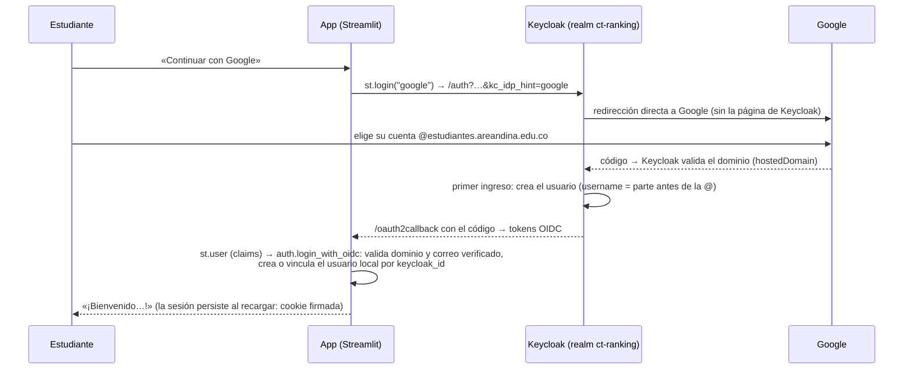

# 15. Inicio de sesión con Google

La pantalla de login ofrece, además del formulario de usuario y contraseña, el botón
**«Continuar con Google»**. Sólo se aceptan **cuentas de Google institucionales**
(`@estudiantes.areandina.edu.co`). Los correos de Areandina están en **Google Workspace**: sus
registros MX públicos apuntan a `aspmx.l.google.com`, así que cada estudiante ya tiene una cuenta
de Google con su correo institucional.

## ¿Tiene costo?

**No.** El inicio de sesión con Google (OAuth 2.0 / OpenID Connect) es gratuito:

- **Proyecto de Google Cloud:** hace falta uno, pero no requiere cuenta de facturación ni tarjeta.
- **Permisos:** sólo se piden los básicos (`openid`, `email`, `profile`), que no se consideran
  sensibles. Por eso no se necesita el proceso de verificación de seguridad de Google.
- **Keycloak** ya trae a Google como proveedor de identidad. No se agrega ningún servicio externo
  aparte de Google.

## Cómo funciona



| Pieza | Dónde | Qué hace |
|-------|-------|----------|
| Botón y retorno | `app/ui/pages/login.py`, `app/ui/components/session.py` | `st.login("google")` y, al volver, `sync_oidc_session()`, que llama a `auth.login_with_oidc`. Si la cuenta no es institucional, muestra el error y el botón «Usar otra cuenta de Google». |
| Configuración de `st.login` | `.streamlit/secrets.toml` (generado) | Lo genera `scripts/write_streamlit_secrets.py` desde `.env`: `redirect_uri` = `APP_URL/oauth2callback`, la cookie firmada con `AUTH_COOKIE_SECRET` (o uno aleatorio que se conserva) y el proveedor `google`, que apunta a Keycloak con `authorize_params = { kc_idp_hint = "google" }`. El archivo está en `.gitignore`. |
| Proveedor en Keycloak | `scripts/configure_keycloak.py` (en `make up`) | Si `GOOGLE_CLIENT_ID` tiene valor, crea o actualiza el proveedor `google` con `hostedDomain = STUDENT_EMAIL_DOMAIN` y `trustEmail` (Google ya verificó el correo), y el *mapper* `username = ${CLAIM.email \| localpart}`. Si está vacío, **quita** el proveedor. También habilita el flujo de navegador del cliente `ct-ranking-app`. |
| Doble validación | `app/auth/service.py` → `login_with_oidc` | Exige `email_verified` y el dominio institucional, y rechaza cuentas deshabilitadas. |
| Cierre de sesión | `session.logout()` | Limpia la sesión de la app y llama a `st.logout()`, que también cierra la sesión en Keycloak. |

Comportamiento:

- **Cuenta ya registrada con el formulario.** Si un estudiante ya tenía cuenta con su correo
  institucional, la primera vez que entra con Google Keycloak le pide **vincular** las cuentas,
  confirmando con su contraseña o con un enlace por correo. Desde entonces puede usar ambos
  métodos.
- **Cuentas creadas con Google.** No necesitan activación por correo y no tienen contraseña
  local. Si la quieren, la pueden definir en Keycloak.
- **2FA.** Con Google, la verificación en dos pasos es la de la propia cuenta de Google. El 2FA
  de Keycloak sólo aplica al login con contraseña.

## Cómo crear las credenciales (paso a paso)

> Lo hace el responsable del proyecto. Las pantallas de Google Cloud cambian con el tiempo; los
> nombres pueden variar un poco.

1. Entra a **https://console.cloud.google.com** con una cuenta de Google.
   - **Recomendado:** usa una cuenta del Google Workspace de Areandina. Así puedes elegir el tipo
     de usuario **Interno** (ver el paso 3).
2. Crea un proyecto (*Select a project → New project*), por ejemplo `ct-ranking`. No necesitas
   facturación.
3. Configura la pantalla de consentimiento (**Google Auth Platform**, antes *APIs & Services →
   OAuth consent screen*):
   - **Branding:** nombre de la app («CT Ranking») y correo de soporte.
   - **Audience (tipo de usuario):**
     - **Internal**, si el proyecto pertenece a la organización de Areandina: sólo entran cuentas
       de esa organización, sin revisión de Google.
     - **External** en otro caso. Mientras esté en modo *Testing*, sólo pueden entrar los
       usuarios de prueba que agregues (hasta 100). Para abrirlo a todos, publícalo
       (*Publish app*); con los permisos básicos no requiere verificación.
   - **Data access (scopes):** `openid`, `.../auth/userinfo.email` y
     `.../auth/userinfo.profile`.
4. Crea el cliente OAuth (**Clients → Create client**):
   - **Application type:** *Web application*.
   - **Authorized redirect URIs:** la URL del *broker* de Keycloak:
     - Desarrollo: `http://localhost:8180/realms/ct-ranking/broker/google/endpoint`
     - Producción: `https://<dominio-de-keycloak>/realms/ct-ranking/broker/google/endpoint`
5. Copia el **Client ID** y el **Client secret** en `.env`:

   ```dotenv
   GOOGLE_CLIENT_ID=1234567890-abc123.apps.googleusercontent.com
   GOOGLE_CLIENT_SECRET=GOCSPX-…
   # Opcional: fija el secreto de la cookie de sesión (si no, se genera uno aleatorio)
   AUTH_COOKIE_SECRET=una-cadena-larga-y-aleatoria
   ```

6. Aplica la configuración y arranca la app:

   ```bash
   make up    # configure_keycloak.py crea el proveedor "google" en Keycloak
   make run   # write_streamlit_secrets.py genera .streamlit/secrets.toml y arranca Streamlit
   ```

7. Abre http://localhost:8501. Debe aparecer **«Continuar con Google»**.

Para **deshabilitarlo**, deja `GOOGLE_CLIENT_ID` vacío y ejecuta `make up`: el proveedor se
elimina de Keycloak y el botón desaparece.

## En producción

- **`APP_URL`:** debe ser la URL pública de la app. El `redirect_uri` de `st.login` es
  `APP_URL/oauth2callback`, y Keycloak lo acepta porque el cliente permite `APP_URL/*`.
- **`KEYCLOAK_URL`:** debe ser la URL pública de Keycloak con HTTPS. La URI de redirección
  registrada en Google debe coincidir con ella.
- **`AUTH_COOKIE_SECRET`:** usa un valor propio, largo y aleatorio. Si cambia, se invalidan las
  sesiones activas.

## Cómo se probó sin credenciales reales

Se usó un **Google simulado**:

- **Montaje:** un realm aparte de Keycloak (`mock-google`) actuando como proveedor OpenID
  Connect, registrado con el alias `google`. Tenía una cuenta institucional y otra `@gmail.com`.
- **Recorrido:** con Selenium y Firefox se probó el recorrido completo:
  1. El botón lleva directo al proveedor.
  2. El usuario se crea y vincula (`eva.institucional`).
  3. La sesión persiste al recargar.
  4. El cierre de sesión funciona.
  5. La cuenta `@gmail.com` se rechaza con un mensaje claro.
- **Limpieza:** al terminar se eliminaron el realm, el proveedor y los usuarios de prueba.
- **Con Google real:** el rechazo de otros dominios ocurre antes, en Keycloak, gracias a
  `hostedDomain`.
