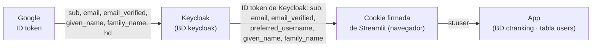

# 15. Inicio de sesión con Google

La pantalla de login ofrece dos acciones con Google, además del formulario de usuario y
contraseña:

| Botón | Pestaña | Qué hace |
|-------|---------|----------|
| **Crear cuenta con Google** | *Crear cuenta* | Crea la cuenta en CT Ranking con el nombre y el correo de Google. La cuenta queda activada de inmediato. Si ya existía, simplemente inicia sesión. |
| **Iniciar sesión con Google** | *Iniciar sesión* | Entra **sólo si la cuenta ya existe**, ya sea creada con Google o con el formulario usando el mismo correo. Si no existe, muestra «No existe una cuenta… Créala primero» con el botón **Crear cuenta con Google**. |
 Sólo se aceptan **cuentas de Google institucionales**
(`@estudiantes.areandina.edu.co`). Los correos de Areandina están en **Google Workspace**: sus
registros MX públicos apuntan a `aspmx.l.google.com`, así que cada estudiante ya tiene una cuenta
de Google con su correo institucional.

## ¿Tiene costo?

**No.** El inicio de sesión con Google (OAuth 2.0 / OpenID Connect) es gratuito:

- **Proyecto de Google Cloud:** hace falta uno, pero no requiere cuenta de facturación ni tarjeta.
- **Permisos:** sólo se piden los básicos (`openid`, `email`, `profile`), que no se consideran
  sensibles. Por eso no se necesita el proceso de verificación de seguridad de Google.
- **Keycloak** ya trae a Google como proveedor de identidad. No se agrega ningún servicio externo
  aparte de Google.

## Cómo funciona

```mermaid
sequenceDiagram
    participant U as Estudiante
    participant A as App (Streamlit)
    participant K as Keycloak (realm ct-ranking)
    participant G as Google
    U->>A: «Crear cuenta con Google» → st.login("googlesignup")<br/>o «Iniciar sesión con Google» → st.login("google")
    A->>K: /auth?…&kc_idp_hint=google (código de autorización OIDC)
    K->>G: redirección directa a Google
    U->>G: elige su cuenta @estudiantes.areandina.edu.co
    G-->>K: ID token de Google → Keycloak exige hd = estudiantes.areandina.edu.co
    K->>K: busca el usuario por la identidad federada;<br/>si no existe, lo crea (username = parte antes de la @)
    K-->>A: /oauth2callback → tokens OIDC de Keycloak
    A->>A: Streamlit guarda los claims + provider en una cookie firmada (st.user)
    A->>A: sync_oidc_session(): provider "googlesignup" → crear si falta<br/>provider "google" → sólo si la cuenta existe
    A-->>U: entra · o «No existe una cuenta… Créala primero»
```

**¿Cómo sabe la app qué botón se usó?**

- El botón se usó en otra página y la sesión de Streamlit se pierde en la redirección.
- Por eso hay **dos proveedores** de `st.login` idénticos: `google` y `googlesignup`. Streamlit
  no admite «_» en el nombre.
- Ambos van al mismo Keycloak y al mismo Google. El nombre del proveedor queda en
  `st.user["provider"]` y le indica a la app la intención.

**Qué pasa con Keycloak cuando alguien sin cuenta pulsa «Iniciar sesión con Google»:**

- Keycloak crea su propio usuario al volver de Google (es su flujo *first broker login*).
- Si la app rechaza el ingreso, **borra ese usuario de Keycloak**
  (`KeycloakClient.delete_broker_only_user`) para no dejar cuentas huérfanas.
- Sólo borra usuarios que tienen identidad de Google y **no tienen contraseña**, así que nunca
  toca una cuenta creada con el formulario.

| Pieza | Dónde | Qué hace |
|-------|-------|----------|
| Botones | `app/ui/pages/login.py` | `st.login("google")` en *Iniciar sesión* y `st.login("googlesignup")` en *Crear cuenta*. Si se rechaza el ingreso, muestra el aviso con «Crear cuenta con Google» y «Usar otra cuenta de Google». |
| Retorno | `app/ui/components/session.py` → `sync_oidc_session()` | Lee `st.user` y llama a `auth.login_with_oidc(..., allow_create=provider == "googlesignup")`. |
| Reglas | `app/auth/service.py` → `login_with_oidc` | Exige `email_verified` y el dominio institucional. Busca la cuenta por `keycloak_id` o por correo. Sin cuenta y sin `allow_create`, lanza `AccountNotFoundError`. Rechaza las cuentas deshabilitadas. |
| Configuración de `st.login` | `.streamlit/secrets.toml` (generado) | Lo genera `scripts/write_streamlit_secrets.py` desde `.env`: `redirect_uri`, cookie firmada y los proveedores `google` y `googlesignup` con `kc_idp_hint=google`. Está en `.gitignore`. |
| Proveedor en Keycloak | `scripts/configure_keycloak.py` (en `make up`) | Crea o actualiza el proveedor `google` (`hostedDomain`, `trustEmail`, *mapper* de username). Si `GOOGLE_CLIENT_ID` está vacío, lo quita. |
| Cierre de sesión | `session.logout()` | Limpia la sesión de la app y llama a `st.logout()`, que también cierra la sesión en Keycloak. |

## Qué datos se obtienen y cómo se guardan



| Etapa | Datos | Dónde se guardan | Para qué |
|-------|-------|------------------|----------|
| **Google → Keycloak** | Identificador de Google (`sub`), correo, «correo verificado», nombre y apellido, y dominio (`hd`). Se piden sólo los permisos `openid email profile`. | **BD `keycloak`**: un usuario con username (parte antes de la @), correo, nombre, apellido y `emailVerified=true`, más el **vínculo federado** (proveedor `google` + identificador de Google + correo). | Que Keycloak reconozca a la persona en los siguientes ingresos. |
| | Tokens de acceso de Google | **No se guardan** (`storeToken: false`) | La app nunca llama a APIs de Google en nombre del estudiante. |
| | Cambios posteriores en Google (p. ej. el nombre) | No se sincronizan (`syncMode: IMPORT`: sólo en el primer ingreso) | Se editan en *Mi perfil*. |
| **Keycloak → navegador** | *Claims* del ID token de Keycloak: `sub` (id del usuario en Keycloak), `email`, `email_verified`, `preferred_username`, `given_name`, `family_name`, más el proveedor usado. | **Cookie de Streamlit** en el navegador: **firmada** con `AUTH_COOKIE_SECRET` (no se puede alterar, pero no está cifrada), `HttpOnly`, `SameSite=Lax`, válida 30 días. Una segunda cookie guarda el ID token para cerrar la sesión en Keycloak. | Mantener la sesión al recargar la página y saber qué botón se usó. |
| **Navegador → app** | Los mismos *claims* (`st.user`) | **BD `ctranking`, tabla `users`**: `keycloak_id` (= `sub`), `username`, `email`, `first_name`, `last_name`, `email_verified=true`, `last_login` y `role=student`. | Perfil, plan académico, foros, retos, etc. |
| | Contraseña | **Ninguna**: una cuenta creada con Google no tiene contraseña en Keycloak ni en la app. | El estudiante entra siempre con Google. Si quiere, puede definir una contraseña en Keycloak. |
| | Foto de perfil de Google | **No se importa** | La foto se sube en *Mi perfil*. |

El procesamiento en la app (`login_with_oidc`) **no guarda nada si se rechaza el ingreso** (otro
dominio, correo sin verificar, cuenta inexistente o deshabilitada). La transacción se revierte y,
si Keycloak había creado un usuario, se borra.

**Otros comportamientos:**

- **Cuenta creada con el formulario.** La primera vez que se usa Google con el mismo correo,
  Keycloak pide **vincular** las cuentas, confirmando con la contraseña o con un enlace por
  correo. Desde entonces sirven ambos métodos y la app la reconoce como la misma cuenta, buscada
  por `keycloak_id` o por correo.
- **2FA.** Con Google, la verificación en dos pasos es la de la propia cuenta de Google. El 2FA
  de Keycloak aplica al login con contraseña.

## Cómo crear las credenciales (paso a paso)

> Lo hace el responsable del proyecto. Las pantallas de Google Cloud cambian con el tiempo; los
> nombres pueden variar un poco.

1. Entra a **https://console.cloud.google.com** con una cuenta de Google.
   - **Recomendado:** usa una cuenta del Google Workspace de Areandina. Así puedes elegir el tipo
     de usuario **Interno** (ver el paso 3).
2. Crea un proyecto (*Select a project → New project*), por ejemplo `ct-ranking`. No necesitas
   facturación.
3. Configura la pantalla de consentimiento (**Google Auth Platform**, antes *APIs & Services →
   OAuth consent screen*):
   - **Branding:** nombre de la app («CT Ranking») y correo de soporte.
   - **Audience (tipo de usuario):**
     - **Internal**, si el proyecto pertenece a la organización de Areandina: sólo entran cuentas
       de esa organización, sin revisión de Google.
     - **External** en otro caso. Mientras esté en modo *Testing*, sólo pueden entrar los
       usuarios de prueba que agregues (hasta 100). Para abrirlo a todos, publícalo
       (*Publish app*); con los permisos básicos no requiere verificación.
   - **Data access (scopes):** `openid`, `.../auth/userinfo.email` y
     `.../auth/userinfo.profile`.
4. Crea el cliente OAuth (**Clients → Create client**):
   - **Application type:** *Web application*.
   - **Authorized redirect URIs:** la URL del *broker* de Keycloak:
     - Desarrollo: `http://localhost:8180/realms/ct-ranking/broker/google/endpoint`
     - Producción: `https://<dominio-de-keycloak>/realms/ct-ranking/broker/google/endpoint`
5. Copia el **Client ID** y el **Client secret** en `.env`:

   ```dotenv
   GOOGLE_CLIENT_ID=1234567890-abc123.apps.googleusercontent.com
   GOOGLE_CLIENT_SECRET=GOCSPX-…
   # Opcional: fija el secreto de la cookie de sesión (si no, se genera uno aleatorio)
   AUTH_COOKIE_SECRET=una-cadena-larga-y-aleatoria
   ```

6. Aplica la configuración y arranca la app:

   ```bash
   make up    # configure_keycloak.py crea el proveedor "google" en Keycloak
   make run   # write_streamlit_secrets.py genera .streamlit/secrets.toml y arranca Streamlit
   ```

7. Abre http://localhost:8501. Deben aparecer **«Iniciar sesión con Google»** (pestaña
   *Iniciar sesión*) y **«Crear cuenta con Google»** (pestaña *Crear cuenta*).

Para **deshabilitarlo**, deja `GOOGLE_CLIENT_ID` vacío y ejecuta `make up`: el proveedor se
elimina de Keycloak y el botón desaparece.

## En producción

- **`APP_URL`:** debe ser la URL pública de la app. El `redirect_uri` de `st.login` es
  `APP_URL/oauth2callback`, y Keycloak lo acepta porque el cliente permite `APP_URL/*`.
- **`KEYCLOAK_URL`:** debe ser la URL pública de Keycloak con HTTPS. La URI de redirección
  registrada en Google debe coincidir con ella.
- **`AUTH_COOKIE_SECRET`:** usa un valor propio, largo y aleatorio. Si cambia, se invalidan las
  sesiones activas.

## Cómo se probó sin credenciales reales

Se usó un **Google simulado**:

- **Montaje:** un realm aparte de Keycloak (`mock-google`) actuando como proveedor OpenID
  Connect, registrado temporalmente con el alias `google`. Tenía una cuenta institucional y otra
  `@gmail.com`.
- **Recorrido**, con Selenium y Firefox:
  1. Aparecen los dos botones, cada uno en su pestaña.
  2. «Iniciar sesión con Google» sin cuenta se rechaza con el aviso, y el usuario creado por
     Keycloak se borra.
  3. «Crear cuenta con Google» crea la cuenta y entra.
  4. «Iniciar sesión con Google» con la cuenta ya creada entra.
  5. «Crear cuenta con Google» con una cuenta `@gmail.com` se rechaza.
- **Limpieza:** al terminar se restauró el proveedor real de Google y se borraron el realm y los
  usuarios de prueba.
- **Con Google real:** el rechazo de otros dominios ocurre antes, en Keycloak, gracias a
  `hostedDomain`.
